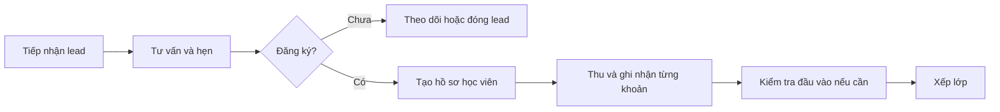
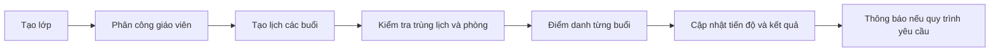
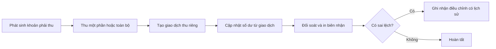

# Báo cáo nghiên cứu và đề xuất nâng cấp website quản lý trung tâm tiếng Anh

## 1. Tóm tắt

Dự án hiện là ứng dụng Django monolith, dùng Django Templates và SQLite mặc định. Mã nguồn đã có các phân hệ nền tảng như học viên, khóa học, lớp học, giáo viên, điểm, học phí và chứng chỉ. Đây là nền phù hợp để tiếp tục phát triển cho một trung tâm đơn lẻ hoặc MVP.

Đối chiếu với các sản phẩm quản lý trung tâm và nền tảng học tập, những khoảng trống đáng ưu tiên là **tuyển sinh và tư vấn, lịch học và điểm danh theo buổi, giao dịch học phí có lịch sử, phân quyền theo vai trò/phạm vi dữ liệu, thông báo và kiểm thử tự động**. Đây là các năng lực vận hành thường được giới thiệu trong sản phẩm thị trường; cần xem là điểm tham khảo, không phải yêu cầu bắt buộc cho mọi trung tâm.

**Khuyến nghị chính:** giữ Python/Django, tiếp tục với kiến trúc monolith có module rõ ràng, củng cố quy tắc nghiệp vụ và bảo mật trước. Chưa có bằng chứng cho thấy cần viết lại bằng framework khác, tách microservice hay triển khai AI. Blockchain chứng chỉ đã có code tích hợp, nhưng cần hoàn thiện và chứng minh nhu cầu xác minh độc lập trước khi đầu tư vận hành.

Phân tích này dựa trên source code và thông tin công khai từ các nhà cung cấp. Mình không xác nhận hệ thống đã triển khai hoặc hoạt động trên môi trường thật, không chạy kiểm thử và không sửa file.

## 2. Nghiên cứu sản phẩm tham khảo

Các mô tả dưới đây là thông tin công khai do nhà cung cấp tự giới thiệu. Chúng giúp nhận diện các nhóm nghiệp vụ thường gặp, nhưng không phải kiểm chứng độc lập về hiệu quả, chất lượng hay mức độ phù hợp.

| Sản phẩm | Nghiệp vụ được giới thiệu công khai | Bài học có thể áp dụng |
|---|---|---|
| [Faceworks](https://faceworks.vn/phan-mem-quan-ly-trung-tam-ngoai-ngu/) | Tuyển sinh/CRM, thi đầu vào, học viên, lớp và thời khóa biểu, điểm danh, học phí, giáo viên, kết quả và dashboard; giới thiệu khả năng tùy chỉnh, nhiều cơ sở và tích hợp. | Liên kết hành trình từ lead đến học viên; thiết kế quyền và báo cáo theo chi nhánh nếu dự án thực sự có nhiều cơ sở. |
| [Nenta](https://nenta.vn/en/) | Trang sản phẩm công khai xác định đây là nền tảng cho trung tâm ngoại ngữ. Thông tin tìm thấy trong lần rà soát này chưa đủ để so sánh đáng tin cậy từng tính năng, giá và giới hạn gói. | Giữ Nenta trong danh sách cần khảo sát demo; không suy luận chi tiết tính năng hoặc giá từ thông tin chưa xác minh. |
| [FLYER LMS-R](https://flyer.vn/flyer-lms/) | Nền tảng dạy và học có thành phần dành cho học sinh, giáo viên, phụ huynh; giới thiệu kho bài tập, giao/chấm bài và ứng dụng AI trong sản phẩm. | Phân biệt phần **quản lý vận hành trung tâm** với phần **hỗ trợ dạy và học**. Một LMS có thể bổ trợ chứ không nhất thiết thay thế phần mềm học phí/CRM. |
| [NiftySchool](https://www.niftyschool.com/features) | Tự giới thiệu là phần mềm cho trường ngoại ngữ nhỏ và vừa; trang tính năng đề cập lịch, điểm danh, theo dõi thanh toán và các cảnh báo nghiệp vụ. | Lịch dạy, chuyên cần, giờ dạy và nhắc việc nên được thiết kế như các quy trình liên kết, không phải các màn hình rời rạc. |
| [CenterOnline](https://center.edu.vn/) | Giới thiệu quản lý khách hàng tiềm năng đến nhập học, chăm sóc, lớp học và tương tác với phụ huynh/học viên. | Có thể cân nhắc CRM và thông báo ở giai đoạn sau nếu trung tâm có nhu cầu theo dõi tuyển sinh, chăm sóc hoặc trao đổi với phụ huynh. |

**Giới hạn nghiên cứu:** thông tin lấy từ trang công khai của nhà cung cấp; không có cơ sở để khẳng định chính xác giá, chất lượng triển khai, tính năng trong từng gói hoặc hiệu quả thực tế. Giá cụ thể nên được hỏi trực tiếp trong demo/khảo sát nhu cầu.

## 3. Hiện trạng source code

| Thành phần | Quan sát từ repo |
|---|---|
| Backend | Python và Django |
| Frontend | Django Templates, CSS và JavaScript; chưa thấy frontend app tách riêng |
| Database | SQLite mặc định; có nhánh cấu hình PostgreSQL nhưng chưa thấy driver PostgreSQL trong `requirements.txt` |
| API | Chưa thấy REST API riêng; URL chủ yếu phục vụ trang Django |
| Cấu trúc nghiệp vụ | Một app `core`, handler đã chia theo nhóm; model vẫn tập trung trong một file |
| Xác thực | Django login/logout và Django Admin |
| Phân quyền | Có `admin_required`, nhưng nhiều handler chỉ yêu cầu đăng nhập |
| Blockchain | Có code Web3 cho phát hành/xác minh chứng chỉ |
| AI | Chưa thấy mã tích hợp AI |
| Kiểm thử | `core/tests.py` còn placeholder; không có căn cứ từ lượt này để nói chức năng đã được kiểm thử |

Các điểm vào của ứng dụng nằm trong [config/urls.py](config/urls.py), [core/urls.py](core/urls.py), model trong [core/models.py](core/models.py) và phân quyền trong [core/permissions.py](core/permissions.py).

### Trạng thái các phân hệ

| Nghiệp vụ | Hiện trạng | Khoảng cách chính |
|---|---|---|
| Học viên | CRUD cơ bản | Chưa thấy tài khoản học viên, phụ huynh, trạng thái học hoặc lịch sử chăm sóc |
| Tuyển sinh/đăng ký | Chưa thấy | Chưa có lead, lịch sử tư vấn, học thử hay chuyển đổi sang nhập học |
| Khóa học/lớp | CRUD và ghi danh cơ bản | Chưa thấy buổi học, lịch lặp, phòng học, trạng thái lớp hoặc lịch sử chuyển lớp |
| Lịch học/xung đột | Chưa thấy lịch buổi học | Chưa thể hiện kiểm tra trùng giáo viên/phòng/ca |
| Điểm danh | Chưa thấy | Chưa có điểm danh theo buổi hoặc quy trình nghỉ/bù |
| Học phí/công nợ | Bản ghi tổng hợp học phí | Chưa có sổ từng khoản thu, hoàn tiền, biên nhận hoặc đối soát |
| Giáo viên | CRUD cơ bản | Chưa có khung giờ sẵn sàng, lịch dạy, lịch sử phân công hay lương |
| Điểm | Có nhập điểm và tính trung bình | Chưa thấy lịch sử sửa, duyệt điểm, hoặc ràng buộc toàn vẹn đầy đủ ở database |
| Thông báo | Chưa thấy quy trình thông báo nghiệp vụ | Cấu hình có `MAILERS`; cần xác nhận vì Django thường dùng `EMAIL_BACKEND` |
| Báo cáo | Dashboard tổng hợp | Chưa thấy báo cáo vận hành/đối soát theo kỳ, lớp hay người phụ trách |
| Tài khoản/phân quyền | Đăng nhập và kiểm tra nhóm Admin | Chưa có phân quyền chi tiết theo vai trò và phạm vi dữ liệu |
| Chứng chỉ | Có service blockchain | Handler tham chiếu template danh sách/xác minh chưa thấy trong cây template |

“Chưa thấy” nghĩa là chưa tìm thấy trong source code đã rà soát, không khẳng định hệ thống bên ngoài repo chắc chắn không có chức năng đó.

## 4. Quy trình nghiệp vụ và khoảng cách

### 4.1. Tuyển sinh → đăng ký → thanh toán → xếp lớp

Repo chưa thể hiện quy trình CRM/lead. Phần hiện có bắt đầu từ danh sách học viên và việc thêm vào lớp, nên thiếu các trạng thái trước nhập học như khách tiềm năng, tư vấn, học thử hoặc kiểm tra đầu vào.

**Đề xuất:** chỉ xây CRM nếu hiện tại có hoạt động tư vấn cần theo dõi. Nếu trung tâm nhỏ, có thể bắt đầu bằng trạng thái lead, nguồn, người phụ trách, lịch nhắc và liên kết sang hồ sơ học viên; chưa cần xây hệ thống marketing lớn.

### 4.2. Lớp → lịch → điểm danh → kết quả

Mã nguồn có lớp, giáo viên, học viên và ngày bắt đầu/kết thúc, nhưng chưa thấy lịch từng buổi và điểm danh. Vì vậy chưa thể hiện cách xử lý nghỉ học, học bù, thay giáo viên hoặc đổi phòng.

**Đề xuất:** thiết kế entity `ClassSession` và `Attendance` nếu trung tâm cần quản lý buổi học. Không nên chỉ thêm trường “lịch” dạng văn bản vào lớp vì sẽ khó tra cứu điểm danh và xử lý buổi bù.

### 4.3. Ghi học phí → công nợ → đối soát

Handler học phí lưu tổng học phí, số đã đóng và ngày thanh toán trong một bản ghi. Khi sửa, số tiền/ngày có thể bị ghi đè; không thể tái dựng đầy đủ nhiều lần thu từ các trường này. Xem [core/handlers/tuition.py](core/handlers/tuition.py).

**Đề xuất:** phân biệt khoản phải thu với giao dịch thanh toán. Mỗi giao dịch cần số tiền, thời gian, phương thức, người thu, mã tham chiếu và trạng thái; sửa sai bằng giao dịch điều chỉnh hoặc hoàn tiền có lưu vết.

### 4.4. Tài khoản → quyền → thao tác

Một số thao tác như nhập điểm hoặc thêm/sửa học phí chỉ yêu cầu đăng nhập; chưa thấy phân quyền theo người phụ trách lớp hay vai trò kế toán. Xem các decorator trong [core/handlers/grades.py](core/handlers/grades.py) và [core/handlers/tuition.py](core/handlers/tuition.py).

**Đề xuất:** xác định vai trò thực tế trước, ví dụ quản trị, học vụ, giáo viên, tài chính. Sau đó kiểm tra quyền trên mỗi hành động và đối tượng dữ liệu ở backend. Không nên tạo các vai trò chỉ vì sản phẩm tham khảo có chúng.

## 5. Rủi ro và vấn đề được xác nhận trong code

### P0 — Bảo mật và dữ liệu thật

- [config/settings.py](config/settings.py) có `DEBUG=True`, `ALLOWED_HOSTS=[]` và `SECRET_KEY` đặt trực tiếp trong file. Đây là cấu hình phát triển, không nên dùng khi mở hệ thống ra môi trường công khai.
- Quyền của người dùng chưa thống nhất: `login_required` cho phép người đăng nhập thực hiện nhiều thao tác mà chưa thấy kiểm tra vai trò hoặc quyền sở hữu dữ liệu.
- Học phí có thể bị chỉnh sửa mà không lưu lịch sử giao dịch; dữ liệu tài chính khó kiểm toán và đối soát.
- Quan hệ xóa cascade ở một số dữ liệu liên quan học viên có thể làm mất điểm/học phí khi xóa hồ sơ; cần chốt chính sách lưu trữ trước khi dùng dữ liệu thật.

### P1 — Toàn vẹn và vận hành nghiệp vụ

- Ghi danh kiểm tra sĩ số rồi thêm học viên; chưa thấy khóa giao dịch/chống tranh chấp khi nhiều yêu cầu đến đồng thời.
- Quan hệ ghi danh trực tiếp nhiều-nhiều không lưu trạng thái, ngày vào lớp hay lịch sử chuyển lớp.
- Các quy tắc điểm được kiểm tra trong handler nhưng chưa thấy ràng buộc tương ứng ở DB; chưa thấy lưu lịch sử thay đổi điểm.
- Dashboard tính công nợ bằng tổng học phí trừ tổng đã đóng, trong khi model có `remaining_amount` chặn số dư âm; cách tính có thể khác nhau trong trường hợp dữ liệu vượt mức.
- Cấu hình chọn PostgreSQL tồn tại nhưng chưa thấy driver trong requirements; chưa đủ căn cứ kết luận nhánh PostgreSQL có thể chạy được.
- `TIME_ZONE = "UTC"` và `LANGUAGE_CODE = "en-us"`; nên xác nhận lại với định dạng và giờ vận hành tại Việt Nam.
- Handler chứng chỉ tham chiếu template chưa thấy trong danh sách file: cần hoàn thiện trước khi coi đây là luồng giao diện hoàn chỉnh.
- Tác vụ blockchain chờ giao dịch trong request web; có rủi ro người dùng phải chờ lâu hoặc request lỗi khi RPC không phản hồi.

## 6. Đánh giá phương án công nghệ

| Tiêu chí | Giữ Django hiện tại, củng cố cấu trúc | Chuyển sang Django REST + React | Chuyển framework/backend khác |
|---|---|---|---|
| Phù hợp nghiệp vụ | Cao cho web quản trị dạng form/bảng | Cao nếu cần giao diện động hoặc nhiều client | Có thể phù hợp, nhưng không giải quyết vấn đề nghiệp vụ tự thân |
| Tốc độ phát triển | Cao; tái sử dụng code | Chậm hơn ban đầu do API, frontend và auth riêng | Thường chậm do viết lại và học/chuyển đổi |
| Độ phức tạp vận hành | Thấp đến vừa | Vừa đến cao: backend, frontend, API và build | Vừa đến cao tùy nền tảng |
| Mở rộng | Đủ cho MVP và tăng trưởng vừa phải | Tốt nếu thực sự cần app/mobile/API | Không chắc tốt hơn nếu quy mô hiện tại nhỏ |
| Tận dụng code | Cao | Model và nghiệp vụ có thể giữ; template cần làm lại | Thấp đến vừa tùy stack |
| Chi phí chuyển đổi | Thấp | Trung bình đến cao | Cao |
| Rủi ro dữ liệu/gián đoạn | Thấp nếu sửa từng phần | Trung bình; cần chuyển giao API và giao diện | Cao hơn do viết lại/migration |
| Khi nào nên chọn | Hệ thống nội bộ, web responsive đáp ứng nhu cầu | Có app di động, portal độc lập, nhiều client/API là yêu cầu thật | Có ràng buộc kỹ thuật cụ thể mà Django không đáp ứng |

**Khuyến nghị chính:** giữ Django và phát triển theo hướng monolith có module nghiệp vụ rõ ràng. Giữ Django Templates hiện tại cho tới khi có yêu cầu cụ thể về nhiều client, trải nghiệm tương tác phức tạp hoặc API công khai.

**Phương án dự phòng:** thêm API có chọn lọc bằng Django REST Framework khi cần tích hợp ứng dụng di động, cổng học viên/phụ huynh hoặc đối tác. Chưa cần tách frontend toàn bộ ngay.

**Không đề xuất viết lại:** vấn đề hiện thấy chủ yếu nằm ở mô hình dữ liệu, quy trình, quyền và kiểm thử, không phải giới hạn rõ ràng của Django. Chuyển framework sẽ tăng chi phí và rủi ro migration mà chưa có lợi ích đủ cụ thể.

## 7. Blockchain và AI

### 7.1. Blockchain

Có code Web3 cho chứng chỉ trong [core/blockchain/blockchain_service.py](core/blockchain/blockchain_service.py), gồm tạo hash, phát hành và xác minh. Trong hash có thông tin liên quan chứng chỉ/học viên; hash không phải mã hóa. Cũng chưa thấy contract Solidity, script deploy hoặc bộ kiểm thử tích hợp trong các file đã rà soát.

Nếu nhu cầu chỉ là trung tâm tự xác minh chứng chỉ, database kèm audit log và chữ ký số có thể ít phức tạp hơn. Blockchain đáng xem xét khi có bên thứ ba cần xác minh độc lập và trung tâm cần bằng chứng toàn vẹn khó sửa đổi.

Nếu giữ blockchain, nên chỉ ghi hash/mã tham chiếu, không ghi dữ liệu nhận dạng học viên lên chain công khai; đồng thời hoàn thiện template, luồng lỗi, retry và quản lý khóa.

### 7.2. AI

Chưa thấy tích hợp AI trong code. Các khả năng hợp lý để thử sau khi dữ liệu và quyền đã ổn định:

| Ý tưởng | Giá trị tiềm năng | Dữ liệu/kiểm soát cần có |
|---|---|---|
| Hỏi đáp chính sách trung tâm | Giảm câu hỏi lặp cho nhân viên | Tài liệu đã duyệt, câu trả lời có nguồn, chuyển nhân viên khi không chắc |
| Hỗ trợ soạn bài/quiz | Tiết kiệm thời gian giáo viên | Giáo viên duyệt; nội dung bám chương trình |
| Tóm tắt báo cáo | Dễ đọc dữ liệu tổng hợp | Số liệu lấy từ truy vấn xác định; ẩn danh khi gửi dịch vụ ngoài |
| Dự đoán nguy cơ nghỉ học | Có thể hỗ trợ chăm sóc học viên | Lịch sử đủ chất lượng, đánh giá sai lệch, con người quyết định |
| Tính học phí/điểm bằng AI | Không phù hợp | Quy tắc tất định nên do code nghiệp vụ xử lý |

Mức chi phí tích hợp AI chưa thể ước lượng tiền khi chưa chốt nhà cung cấp, lượng sử dụng và chính sách dữ liệu. Nên bắt đầu bằng một thử nghiệm nhỏ, không đưa hồ sơ cá nhân hoặc điểm học viên ra dịch vụ ngoài trước khi có đánh giá dữ liệu và quyền riêng tư.

## 8. Danh sách tính năng: giữ, sửa, bổ sung, hoãn

| Quyết định | Phạm vi |
|---|---|
| **Giữ** | Django, Django Templates, CRUD học viên/khóa học/lớp/giáo viên/điểm; cấu trúc handler hiện có |
| **Sửa trước** | Cấu hình môi trường/bảo mật, phân quyền backend, cách lưu học phí, ràng buộc dữ liệu, template chứng chỉ |
| **Bổ sung khi nghiệp vụ cần** | Giao dịch học phí, ghi danh có trạng thái/lịch sử, lịch buổi học và điểm danh, audit log, kiểm thử |
| **Bổ sung nếu trung tâm vận hành tuyển sinh** | Lead/CRM, tư vấn, học thử/đầu vào và nhắc việc |
| **Hoãn** | React/API toàn hệ thống, microservices, ứng dụng di động, dự đoán AI, thanh toán online và blockchain production cho tới khi có yêu cầu và tiêu chí rõ |

## 9. Lộ trình nâng cấp và ước lượng công sức tương đối

Ước lượng dưới đây là **ngày công của một lập trình viên**, dựa trên giả định một trung tâm, một môi trường staging, chưa có tích hợp thanh toán/email bên ngoài và dữ liệu chưa quá lớn. Đây là mức sơ bộ để so sánh thứ tự ưu tiên, không phải cam kết thời gian. Chưa tính thời gian khảo sát người dùng, nhập/chuyển dữ liệu lịch sử hay phê duyệt chính sách.

| Giai đoạn | Công việc | Kết quả/tiêu chí nghiệm thu | Công sức tương đối |
|---|---|---|---:|
| 1. Ổn định nền tảng | Tách cấu hình theo môi trường; chốt DB đích; chuẩn hóa quyền cho các handler hiện có; xác định backup/restore | Môi trường chạy không dùng secret trong source; vai trò và quyền được lập thành ma trận; phục hồi bản backup được diễn tập | 4–8 ngày |
| 2. Bảo vệ dữ liệu và quy tắc lõi | Thiết kế lưu vết thao tác quan trọng; rà soát xóa dữ liệu; bổ sung ràng buộc và xử lý ghi danh đồng thời; tạo bộ kiểm thử cho các quy tắc chính | Không ghi danh vượt sĩ số khi có yêu cầu đồng thời; điểm ngoài khoảng bị từ chối cả tại tầng ứng dụng; thay đổi tài chính/điểm có dấu vết | 5–10 ngày |
| 3. Hoàn thiện học phí | Tách khoản phải thu và giao dịch thu; hỗ trợ trả nhiều lần, điều chỉnh/hoàn tiền theo quy tắc; báo cáo số dư và biên nhận | Có thể truy nguyên mỗi khoản thu tới người thực hiện/thời gian; dashboard và danh sách dùng cùng quy tắc công nợ | 7–14 ngày |
| 4. Hoàn thiện lớp học | Thiết kế ghi danh có trạng thái; lịch buổi học; điểm danh; ngoại lệ nghỉ/bù/chuyển lớp nếu trung tâm yêu cầu | Xem được lịch theo lớp/giáo viên; ghi danh và điểm danh không tạo dữ liệu trùng; thay đổi có lịch sử | 10–20 ngày |
| 5. Tuyển sinh và thông báo | Chỉ khi quy trình thực tế cần CRM; xây trạng thái lead, lịch chăm sóc, liên kết học viên và nhắc việc | Có thể truy từ lead đến học viên và biết người phụ trách/trạng thái; thông báo có trạng thái gửi/lỗi nếu tích hợp | 8–18 ngày |
| 6. Chứng chỉ, báo cáo, vận hành | Hoàn thiện template; quyết định blockchain hay chữ ký số/audit log; bổ sung báo cáo, logging và tài liệu triển khai | Người dùng tra cứu/chứng minh chứng chỉ theo luồng đã chọn; có log lỗi và hướng dẫn vận hành | 5–12 ngày |

Các giai đoạn có thể thu nhỏ hoặc bỏ tùy nghiệp vụ. Ví dụ, nếu trung tâm chưa cần CRM thì hoãn giai đoạn 5; nếu chứng chỉ không phải nghiệp vụ cốt lõi thì chưa cần đầu tư blockchain.

## 10. Rủi ro và câu hỏi cần xác nhận

1. Trung tâm có một cơ sở hay nhiều cơ sở?
2. Hiện có các vai trò nào: quản trị, học vụ, tư vấn, kế toán, giáo viên, học viên/phụ huynh?
3. Học phí được thu một lần hay nhiều đợt? Có bảo lưu, chuyển lớp, miễn giảm hoặc hoàn tiền không?
4. Có cần lịch buổi học, điểm danh và học bù trong hệ thống không?
5. Ai cần xác minh chứng chỉ, và họ có cần kiểm tra độc lập ngoài trung tâm không?
6. Có dữ liệu hiện hữu cần nhập vào hệ thống không? Nếu có, khối lượng và định dạng ra sao?
7. Hệ thống sẽ chạy nội bộ, trên một máy chủ riêng hay trên dịch vụ cloud?

## 11. Kết luận

1. **Ưu tiên sửa trước khi vận hành thực tế:** cấu hình bảo mật, phân quyền theo vai trò và dữ liệu, lưu vết học phí, quy tắc toàn vẹn, backup/restore và kiểm thử các luồng chính.
2. **Nên giữ công nghệ hiện tại:** Django monolith đáp ứng tốt hơn nhu cầu đã thấy so với chi phí và rủi ro viết lại. Chỉ bổ sung API khi có client hoặc tích hợp cụ thể cần đến.
3. **Đáng đầu tư sau khi chốt nghiệp vụ:** sổ giao dịch học phí; lịch buổi học/điểm danh nếu trung tâm cần; CRM nếu có quy trình tuyển sinh. Hoãn AI, microservices và blockchain production cho tới khi có mục tiêu rõ, dữ liệu phù hợp và tiêu chí nghiệm thu.

## Nguồn tham khảo

Nguồn sản phẩm là nội dung do nhà cung cấp công bố: [Faceworks](https://faceworks.vn/phan-mem-quan-ly-trung-tam-ngoai-ngu/), [Nenta](https://nenta.vn/en/), [FLYER LMS-R](https://flyer.vn/flyer-lms/), [NiftySchool](https://www.niftyschool.com/features), [CenterOnline](https://center.edu.vn/). Chưa xác minh giá và chất lượng triển khai độc lập.
