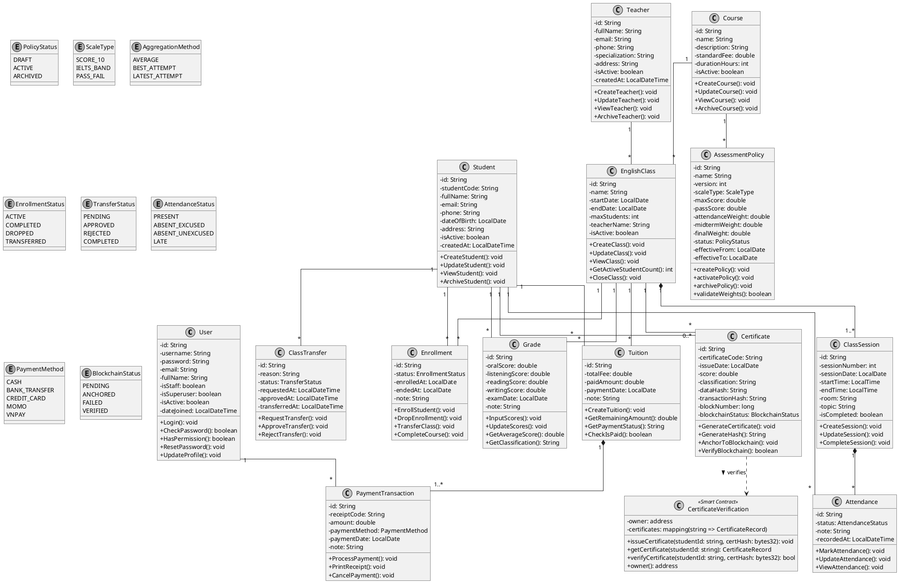

# TÀI LIỆU PHÂN TÍCH HỆ THỐNG VÀ ĐẶC TẢ SƠ ĐỒ LỚP (CLASS DIAGRAM)
## DỰ ÁN: VISTA – HỆ THỐNG QUẢN LÝ TRUNG TÂM TIẾNG ANH TÍCH HỢP BLOCKCHAIN
*Tài liệu được xây dựng bởi Chuyên gia Phân tích Thiết kế Hệ thống (System Analyst)*
*Ngày cập nhật: 07/11/2026 - Chuẩn hóa kiểu dữ liệu UML OOP khớp 100% mẫu đồ họa giáo trình*

---

# MỤC LỤC
1. [Phần 1: Bảng quy chuẩn đối sánh kiểu dữ liệu (Django ORM $\rightarrow$ UML / OOP)](#phần-1-bảng-quy-chuẩn-đối-sánh-kiểu-dữ-liệu)
2. [Phần 2: Danh sách các lớp theo phân hệ nghiệp vụ](#phần-2-danh-sách-các-lớp-theo-phân-hệ-nghiệp-vụ)
3. [Phần 3: Chi tiết thuộc tính, kiểu dữ liệu và phương thức từng lớp](#phần-3-chi-tiết-thuộc-tính-kiểu-dữ-liệu-và-phương-thức-từng-lớp)
4. [Phần 4: Bảng quan hệ và bội số giữa các lớp (Multiplicity)](#phần-4-bảng-quan-hệ-và-bội-số-giữa-các-lớp-multiplicity)
5. [Phần 5: Danh sách quan hệ kế thừa và hợp thành (Composition/Aggregation)](#phần-5-danh-sách-quan-hệ-kế-thừa-và-hợp-thành)
6. [Phần 6: Định dạng các kiểu dữ liệu liệt kê (Enumerations)](#phần-6-định-dạng-các-kiểu-dữ-liệu-liệt-kê-enumerations)
7. [Phần 7: Mã nguồn PlantUML đồ họa đen trắng chuẩn giáo trình](#phần-7-mã-nguồn-plantuml-đồ-họa-đen-trắng-chuẩn-giáo-trình)

---

# PHẦN 1: BẢNG QUY CHUẨN ĐỐI SÁNH KIỂU DỮ LIỆU

Trong thiết kế hướng đối tượng (OOAD) và vẽ sơ đồ lớp UML, kiểu dữ liệu cần tuân theo chuẩn ngôn ngữ lập trình OOP (Java/C#/UML 2.5), **không được sử dụng kiểu vật lý của cơ sở dữ liệu** (như `BigInt`, `Decimal(12,2)`, `Text`, `Date`, `DateTime`).

Dưới đây là bảng đối sánh ánh xạ trực tiếp từ Django Model sang UML Class Diagram (khớp hoàn toàn với hình mẫu tham chiếu):

| STT | Kiểu dữ liệu trong Django ORM | Kiểu dữ liệu CSDL SQL (Không dùng trong UML) | Kiểu dữ liệu UML / OOP chuẩn (Đang áp dụng) | Ý nghĩa & Ví dụ trong hệ thống |
|:---:|---|---|---|---|
| **1** | `BigAutoField` / `AutoField` | `BIGINT`, `INT AUTO_INCREMENT` | `String` *(hoặc `Long`)* | Định danh duy nhất: `- id: String` (theo hình mẫu) |
| **2** | `CharField`, `TextField` | `VARCHAR`, `TEXT`, `LONGTEXT` | `String` | Chuỗi ký tự, văn bản: `fullName: String`, `address: String` |
| **3** | `DateField` | `DATE` | `LocalDate` | Ngày không có giờ: `dateOfBirth: LocalDate`, `startDate: LocalDate` |
| **4** | `TimeField` | `TIME` | `LocalTime` | Giờ không có ngày: `startTime: LocalTime`, `endTime: LocalTime` |
| **5** | `DateTimeField` | `DATETIME`, `TIMESTAMP` | `LocalDateTime` | Thời điểm chính xác: `createdAt: LocalDateTime`, `dateJoined: LocalDateTime` |
| **6** | `DecimalField` | `DECIMAL(p, s)`, `NUMERIC` | `double` | Điểm số, học phí, tiền tệ: `standardFee: double`, `oralScore: double` |
| **7** | `IntegerField`, `PositiveIntegerField` | `INTEGER`, `SMALLINT UNSIGNED` | `int` | Số lượng, thời lượng, số buổi: `maxStudents: int`, `durationHours: int` |
| **8** | `PositiveBigIntegerField` | `BIGINT UNSIGNED` | `long` | Số khối blockchain: `blockNumber: long` |
| **9** | `BooleanField` | `TINYINT(1)`, `BOOLEAN` | `boolean` *(chữ thường)* | Cờ bật/tắt: `isActive: boolean`, `isStaff: boolean`, `isRequired: boolean` |
| **10** | `Choices` (Thuộc tính trạng thái) | `VARCHAR` | `Enum` *(Tên Enum riêng)* | Trạng thái nghiệp vụ: `EnrollmentStatus`, `AttendanceStatus`, `PolicyStatus` |

---

# PHẦN 2: DANH SÁCH CÁC LỚP THEO PHÂN HỆ NGHIỆP VỤ

Hệ thống VISTA gồm **15 lớp cốt lõi** (sau khi gộp quy chế đánh giá thành 1 lớp thống nhất), phân bổ theo 7 phân hệ nghiệp vụ:

| STT | Phân hệ nghiệp vụ | Danh sách các lớp | Vai trò cốt lõi |
|---|---|---|---|
| 1 | **Quản trị người dùng & Phân quyền** | `User` | Tài khoản nhân viên, giáo vụ, quản trị viên đăng nhập hệ thống. |
| 2 | **Quản lý Đào tạo & Khóa học** | `Course`, `Teacher`, `Student`, `EnglishClass`, `Enrollment`, `ClassTransfer` | Quản lý danh mục khóa học, hồ sơ giảng viên, học viên, lớp học và ghi danh/chuyển lớp. |
| 3 | **Quản lý Quy chế đánh giá** | `AssessmentPolicy` | Quản lý quy chế đánh giá thống nhất, bao gồm thang điểm, điều kiện đạt và tỷ trọng các thành phần điểm. |
| 4 | **Quản lý Điểm & Đánh giá** | `Grade` | Quản lý bảng điểm thành phần 4 kỹ năng và kết quả học tập. |
| 5 | **Quản lý Buổi học & Điểm danh** | `ClassSession`, `Attendance` | Quản lý lịch học theo ca/phòng và theo dõi chuyên cần học viên. |
| 6 | **Quản lý Tài chính & Học phí** | `Tuition`, `PaymentTransaction` | Theo dõi nghĩa vụ học phí và các đợt thanh toán, biên lai thu tiền. |
| 7 | **Chứng chỉ & Blockchain** | `Certificate`, `CertificateVerification` | Cấp phát chứng chỉ, băm SHA-256 và neo xác minh trên Smart Contract. |

---

# PHẦN 3: CHI TIẾT THUỘC TÍNH, KIỂU DỮ LIỆU VÀ PHƯƠNG THỨC TỪNG LỚP

### 1. Lớp `User`
* **Vai trò:** Đại diện cho tài khoản nhân viên (Admin, Quản lý đào tạo, Kế toán) truy cập hệ thống.
* **Chi tiết cấu trúc:**
| Thành phần | Tên | Kiểu dữ liệu | Ý nghĩa |
|---|---|---|---|
| **Thuộc tính** | `id` | `String` | Khóa chính |
| | `username` | `String` | Tên tài khoản |
| | `password` | `String` | Mật khẩu băm (BCrypt/Argon2) |
| | `email` | `String` | Email liên hệ |
| | `fullName` | `String` | Họ và tên nhân sự |
| | `isStaff` | `boolean` | Quyền truy cập quản trị |
| | `isSuperuser` | `boolean` | Quản trị tối cao |
| | `isActive` | `boolean` | Trạng thái hoạt động |
| | `dateJoined` | `LocalDateTime` | Thời điểm tạo tài khoản |
| **Phương thức** | `+ Login(): void` | `void` | Đăng nhập hệ thống |
| | `+ CheckPassword(rawPassword: String): boolean` | `boolean` | Xác thực mật khẩu |
| | `+ HasPermission(perm: String): boolean` | `boolean` | Kiểm tra quyền hạn |
| | `+ ResetPassword(): void` | `void` | Cấp lại mật khẩu |
| | `+ UpdateProfile(): void` | `void` | Cập nhật thông tin |

---

### 2. Lớp `Teacher`
* **Vai trò:** Quản lý hồ sơ giảng viên của trung tâm.
* **Chi tiết cấu trúc:**
| Thành phần | Tên | Kiểu dữ liệu | Ý nghĩa |
|---|---|---|---|
| **Thuộc tính** | `id` | `String` | Khóa chính |
| | `fullName` | `String` | Họ và tên giảng viên |
| | `email` | `String` | Email giảng viên |
| | `phone` | `String` | Số điện thoại |
| | `specialization` | `String` | Chuyên môn giảng dạy (IELTS, TOEIC, Giao tiếp) |
| | `address` | `String` | Địa chỉ cư trú |
| | `isActive` | `boolean` | Trạng thái giảng dạy |
| | `createdAt` | `LocalDateTime` | Thời điểm tiếp nhận hồ sơ |
| **Phương thức** | `+ CreateTeacher(): void` | `void` | Thêm giảng viên mới |
| | `+ UpdateTeacher(): void` | `void` | Cập nhật giảng viên |
| | `+ ViewTeacher(): void` | `void` | Xem chi tiết hồ sơ |
| | `+ ArchiveTeacher(): void` | `void` | Lưu trữ / vô hiệu hóa hồ sơ |

---

### 3. Lớp `Course`
* **Vai trò:** Quản lý danh mục chương trình đào tạo của trung tâm.
* **Chi tiết cấu trúc:**
| Thành phần | Tên | Kiểu dữ liệu | Ý nghĩa |
|---|---|---|---|
| **Thuộc tính** | `id` | `String` | Khóa chính |
| | `name` | `String` | Tên khóa học |
| | `description` | `String` | Mô tả nội dung khóa học |
| | `standardFee` | `double` | Học phí tiêu chuẩn |
| | `durationHours` | `int` | Thời lượng đào tạo (số giờ/buổi) |
| | `isActive` | `boolean` | Trạng thái hoạt động |
| **Phương thức** | `+ CreateCourse(): void` | `void` | Tạo khóa học mới |
| | `+ UpdateCourse(): void` | `void` | Cập nhật khóa học |
| | `+ ViewCourse(): void` | `void` | Xem chi tiết |
| | `+ ArchiveCourse(): void` | `void` | Lưu trữ khóa học |

---

### 4. Lớp `AssessmentPolicy` (Đã gộp thành phần điểm thành 1 lớp thống nhất)
* **Vai trò:** Quản lý toàn diện quy chế đánh giá, bao gồm thang điểm, điều kiện đạt chuẩn và cơ cấu tỷ trọng các thành phần điểm thi.
* **Chi tiết cấu trúc:**
| Thành phần | Tên | Kiểu dữ liệu | Ý nghĩa |
|---|---|---|---|
| **Thuộc tính** | `id` | `String` | Khóa chính |
| | `name` | `String` | Tên quy chế (vd: Quy chế điểm IELTS 2026) |
| | `version` | `int` | Phiên bản quy chế |
| | `scaleType` | `ScaleType` | Thang điểm (Điểm 10, IELTS Band, Pass/Fail) |
| | `maxScore` | `double` | Điểm trần tối đa (10.0 hoặc 9.0) |
| | `passScore` | `double` | Điểm đạt chuẩn tối thiểu |
| | `attendanceWeight` | `double` | Tỷ trọng điểm chuyên cần (vd: 10% = 0.1) |
| | `midtermWeight` | `double` | Tỷ trọng bài thi giữa kỳ (vd: 30% = 0.3) |
| | `finalWeight` | `double` | Tỷ trọng bài thi cuối kỳ (vd: 60% = 0.6) |
| | `status` | `PolicyStatus` | Trạng thái (DRAFT, ACTIVE, ARCHIVED) |
| | `effectiveFrom` | `LocalDate` | Ngày bắt đầu áp dụng |
| | `effectiveTo` | `LocalDate` | Ngày hết hạn hiệu lực |
| **Phương thức** | `+ createPolicy(): void` | `void` | Tạo quy chế mới |
| | `+ activatePolicy(): void` | `void` | Kích hoạt áp dụng cho các lớp học |
| | `+ archivePolicy(): void` | `void` | Lưu trữ quy chế cũ |
| | `+ validateWeights(): boolean` | `boolean` | Kiểm tra tổng tỷ trọng các cột điểm = 100% |

---

### 6. Lớp `EnglishClass`
* **Vai trò:** Lớp học cụ thể được mở theo một khóa học.
* **Chi tiết cấu trúc:**
| Thành phần | Tên | Kiểu dữ liệu | Ý nghĩa |
|---|---|---|---|
| **Thuộc tính** | `id` | `String` | Khóa chính |
| | `name` | `String` | Tên lớp học (vd: IELTS-2026A) |
| | `startDate` | `LocalDate` | Ngày khai giảng |
| | `endDate` | `LocalDate` | Ngày bế giảng dự kiến |
| | `maxStudents` | `int` | Sĩ số tối đa |
| | `teacherName` | `String` | Tên giảng viên phụ trách |
| | `isActive` | `boolean` | Trạng thái hoạt động |
| **Phương thức** | `+ CreateClass(): void` | `void` | Mở lớp học |
| | `+ UpdateClass(): void` | `void` | Cập nhật thông tin |
| | `+ ViewClass(): void` | `void` | Xem danh sách học viên |
| | `+ GetActiveStudentCount(): int` | `int` | Đếm học viên đang học |
| | `+ CloseClass(): void` | `void` | Kết thúc lớp học |

---

### 7. Lớp `Student`
* **Vai trò:** Quản lý hồ sơ nhân thân học viên.
* **Chi tiết cấu trúc:**
| Thành phần | Tên | Kiểu dữ liệu | Ý nghĩa |
|---|---|---|---|
| **Thuộc tính** | `id` | `String` | Khóa chính |
| | `studentCode` | `String` | Mã học viên hiển thị (vd: HV-0012) |
| | `fullName` | `String` | Họ và tên học viên |
| | `email` | `String` | Email |
| | `phone` | `String` | Số điện thoại |
| | `dateOfBirth` | `LocalDate` | Ngày tháng năm sinh |
| | `address` | `String` | Địa chỉ cư trú |
| | `isActive` | `boolean` | Trạng thái hoạt động |
| | `createdAt` | `LocalDateTime` | Thời điểm tiếp nhận hồ sơ |
| **Phương thức** | `+ CreateStudent(): void` | `void` | Tiếp nhận học viên |
| | `+ UpdateStudent(): void` | `void` | Cập nhật hồ sơ |
| | `+ ViewStudent(): void` | `void` | Xem thông tin chi tiết |
| | `+ ArchiveStudent(): void` | `void` | Lưu trữ hồ sơ |

---

### 8. Lớp `Enrollment`
* **Vai trò:** Quản lý tiến trình học tập của học viên trong một lớp cụ thể.
* **Chi tiết cấu trúc:**
| Thành phần | Tên | Kiểu dữ liệu | Ý nghĩa |
|---|---|---|---|
| **Thuộc tính** | `id` | `String` | Khóa chính |
| | `status` | `EnrollmentStatus` | Trạng thái (ACTIVE, COMPLETED, DROPPED, TRANSFERRED) |
| | `enrolledAt` | `LocalDate` | Ngày nhập học |
| | `endedAt` | `LocalDate` | Ngày hoàn thành / thôi học |
| | `note` | `String` | Ghi chú |
| **Phương thức** | `+ EnrollStudent(): void` | `void` | Ghi danh vào lớp |
| | `+ DropEnrollment(): void` | `void` | Bảo lưu / thôi học |
| | `+ TransferClass(): void` | `void` | Đánh dấu chuyển lớp |
| | `+ CompleteCourse(): void` | `void` | Đạt điều kiện hoàn thành |

---

### 9. Lớp `ClassTransfer`
* **Vai trò:** Nhật ký và phê duyệt yêu cầu chuyển lớp của học viên.
* **Chi tiết cấu trúc:**
| Thành phần | Tên | Kiểu dữ liệu | Ý nghĩa |
|---|---|---|---|
| **Thuộc tính** | `id` | `String` | Khóa chính |
| | `reason` | `String` | Lý do chuyển lớp |
| | `status` | `TransferStatus` | Trạng thái (PENDING, APPROVED, REJECTED, COMPLETED) |
| | `requestedAt` | `LocalDateTime` | Thời điểm nộp đơn |
| | `approvedAt` | `LocalDateTime` | Thời điểm duyệt |
| | `transferredAt` | `LocalDateTime` | Thời điểm thực thi chuyển |
| **Phương thức** | `+ RequestTransfer(): void` | `void` | Tạo phiếu xin chuyển lớp |
| | `+ ApproveTransfer(): void` | `void` | Phê duyệt chuyển lớp |
| | `+ RejectTransfer(): void` | `void` | Từ chối yêu cầu |

---

### 10. Lớp `ClassSession`
* **Vai trò:** Từng buổi học cụ thể trên thời khóa biểu của lớp học.
* **Chi tiết cấu trúc:**
| Thành phần | Tên | Kiểu dữ liệu | Ý nghĩa |
|---|---|---|---|
| **Thuộc tính** | `id` | `String` | Khóa chính |
| | `sessionNumber` | `int` | Số thứ tự buổi học (Buổi 1, 2...) |
| | `sessionDate` | `LocalDate` | Ngày diễn ra buổi học |
| | `startTime` | `LocalTime` | Giờ bắt đầu |
| | `endTime` | `LocalTime` | Giờ kết thúc |
| | `room` | `String` | Phòng học |
| | `topic` | `String` | Chủ đề bài giảng |
| | `isCompleted` | `boolean` | Đã hoàn thành buổi học |
| **Phương thức** | `+ CreateSession(): void` | `void` | Tạo lịch buổi học |
| | `+ UpdateSession(): void` | `void` | Điều chỉnh lịch học/đổi phòng |
| | `+ CompleteSession(): void` | `void` | Xác nhận hoàn thành buổi dạy |

---

### 11. Lớp `Attendance`
* **Vai trò:** Điểm danh học viên theo từng buổi học.
* **Chi tiết cấu trúc:**
| Thành phần | Tên | Kiểu dữ liệu | Ý nghĩa |
|---|---|---|---|
| **Thuộc tính** | `id` | `String` | Khóa chính |
| | `status` | `AttendanceStatus` | Trạng thái (PRESENT, ABSENT_EXCUSED, ABSENT_UNEXCUSED, LATE) |
| | `note` | `String` | Ghi chú lý do vắng |
| | `recordedAt` | `LocalDateTime` | Thời điểm điểm danh |
| **Phương thức** | `+ MarkAttendance(): void` | `void` | Ghi nhận điểm danh |
| | `+ UpdateAttendance(): void` | `void` | Chỉnh sửa trạng thái |
| | `+ ViewAttendance(): void` | `void` | Xem lịch sử chuyên cần |

---

### 12. Lớp `Grade`
* **Vai trò:** Quản lý bảng điểm các kỹ năng và kết quả kiểm tra của học viên.
* **Chi tiết cấu trúc:**
| Thành phần | Tên | Kiểu dữ liệu | Ý nghĩa |
|---|---|---|---|
| **Thuộc tính** | `id` | `String` | Khóa chính |
| | `oralScore` | `double` | Điểm Nói (Speaking) |
| | `listeningScore` | `double` | Điểm Nghe (Listening) |
| | `readingScore` | `double` | Điểm Đọc (Reading) |
| | `writingScore` | `double` | Điểm Viết (Writing) |
| | `examDate` | `LocalDate` | Ngày kiểm tra/thi |
| | `note` | `String` | Nhận xét của giảng viên |
| **Phương thức** | `+ InputScores(): void` | `void` | Nhập điểm |
| | `+ UpdateScores(): void` | `void` | Chỉnh sửa điểm |
| | `+ GetAverageScore(): double` | `double` | Tính điểm trung bình tổng kết |
| | `+ GetClassification(): String`| `String` | Xếp loại học lực (Giỏi, Khá, TB) |

---

### 13. Lớp `Tuition`
* **Vai trò:** Quản lý nghĩa vụ học phí của học viên khi tham gia lớp học.
* **Chi tiết cấu trúc:**
| Thành phần | Tên | Kiểu dữ liệu | Ý nghĩa |
|---|---|---|---|
| **Thuộc tính** | `id` | `String` | Khóa chính |
| | `totalFee` | `double` | Tổng học phí phải nộp |
| | `paidAmount` | `double` | Số tiền đã thanh toán |
| | `paymentDate` | `LocalDate` | Ngày hoàn tất học phí |
| | `note` | `String` | Ghi chú miễn giảm |
| **Phương thức** | `+ CreateTuition(): void` | `void` | Khởi tạo phiếu học phí |
| | `+ GetRemainingAmount(): double`| `double` | Tính công nợ còn lại |
| | `+ GetPaymentStatus(): String`| `String` | Lấy tình trạng (Đã nộp đủ, Còn nợ) |
| | `+ CheckIsPaid(): boolean` | `boolean` | Đã thanh toán đầy đủ chưa |

---

### 14. Lớp `PaymentTransaction`
* **Vai trò:** Nhật ký giao dịch từng đợt nộp học phí và in biên lai thu tiền.
* **Chi tiết cấu trúc:**
| Thành phần | Tên | Kiểu dữ liệu | Ý nghĩa |
|---|---|---|---|
| **Thuộc tính** | `id` | `String` | Khóa chính |
| | `receiptCode` | `String` | Mã biên lai thu tiền (vd: HD-2026-001) |
| | `amount` | `double` | Số tiền đóng trong đợt |
| | `paymentMethod` | `PaymentMethod` | Phương thức nộp (Tiền mặt, Chuyển khoản, MoMo...) |
| | `paymentDate` | `LocalDate` | Ngày nộp tiền |
| | `note` | `String` | Ghi chú thanh toán |
| **Phương thức** | `+ ProcessPayment(): void`| `void` | Ghi nhận thu tiền |
| | `+ PrintReceipt(): void` | `void` | Xuất file/in biên lai thu phí |
| | `+ CancelPayment(): void` | `void` | Hủy giao dịch lập sai |

---

### 15. Lớp `Certificate`
* **Vai trò:** Quản lý chứng chỉ tốt nghiệp và lưu trữ bằng chứng Blockchain.
* **Chi tiết cấu trúc:**
| Thành phần | Tên | Kiểu dữ liệu | Ý nghĩa |
|---|---|---|---|
| **Thuộc tính** | `id` | `String` | Khóa chính |
| | `certificateCode`| `String` | Mã số chứng chỉ (vd: CERT-2026-0089) |
| | `issueDate` | `LocalDate` | Ngày cấp bằng |
| | `score` | `double` | Điểm tổng kết in trên bằng |
| | `classification`| `String` | Xếp loại tốt nghiệp (Xuất sắc, Giỏi, Khá) |
| | `dataHash` | `String` | Mã băm SHA-256 dữ liệu chứng chỉ |
| | `transactionHash`| `String` | Transaction hash giao dịch Ethereum |
| | `blockNumber` | `long` | Số thứ tự Block ghi nhận |
| | `blockchainStatus`| `BlockchainStatus`| Trạng thái xác thực Blockchain |
| **Phương thức** | `+ GenerateCertificate(): void`| `void` | Cấp phát chứng chỉ |
| | `+ GenerateHash(): String` | `String` | Tính toán băm SHA-256 |
| | `+ AnchorToBlockchain(): void`| `void` | Gửi băm lên mạng Blockchain |
| | `+ VerifyBlockchain(): boolean`| `boolean`| Xác minh tính toàn vẹn bất biến |

---

### 16. Lớp `CertificateVerification` («Smart Contract»)
* **Vai trò:** Hợp đồng thông minh Solidity chạy trên Blockchain Ethereum.
* **Chi tiết cấu trúc:**
| Thành phần | Tên | Kiểu dữ liệu | Ý nghĩa |
|---|---|---|---|
| **Thuộc tính** | `owner` | `address` | Địa chỉ ví quản trị viên hợp đồng |
| | `certificates` | `mapping(string => CertificateRecord)` | Bản đồ ánh xạ mã chứng chỉ sang bản ghi băm |
| **Phương thức** | `+ issueCertificate(string, bytes32): void` | `void` | Ghi mã băm chứng chỉ lên sổ cái |
| | `+ getCertificate(string): tuple` | `tuple` | Tra cứu chứng chỉ trên Blockchain |
| | `+ verifyCertificate(string, bytes32): bool` | `bool` | Kiểm tra tính xác thực của chứng chỉ |
| | `+ owner(): address` | `address` | Lấy địa chỉ chủ sở hữu hợp đồng |

---

# PHẦN 4: BẢNG QUAN HỆ VÀ BỘI SỐ GIỮA CÁC LỚP (MULTIPLICITY)

| Lớp nguồn (Source) | Bội số | Quan hệ | Bội số | Lớp đích (Target) | Ý nghĩa nghiệp vụ |
|---|:---:|:---:|:---:|---|---|
| `Course` | **1** | Liên kết (Association) | **\*** | `EnglishClass` | Một khóa học có thể mở nhiều lớp học khác nhau. |
| `Course` | **1** | Liên kết (Association) | **\*** | `AssessmentPolicy` | Một khóa học có thể áp dụng các phiên bản quy chế theo từng năm. |
| `Teacher` | **1** | Liên kết (Association) | **\*** | `EnglishClass` | Một giảng viên phụ trách chuyên môn nhiều lớp học. |
| `EnglishClass` | **1** | Hợp thành (Composition) | **1..\*** | `ClassSession` | Một lớp học bao gồm một chuỗi các buổi học; hủy lớp học thì lịch học cũng bị hủy. |
| `ClassSession` | **1** | Hợp thành (Composition) | **\*** | `Attendance` | Một buổi học có danh sách điểm danh; buổi học bị xóa thì nhật ký điểm danh buổi đó bị xóa. |
| `Student` | **1** | Liên kết (Association) | **\*** | `Attendance` | Một học viên có nhiều lượt điểm danh theo các buổi học. |
| `EnglishClass` | **1** | Liên kết (Association) | **\*** | `Enrollment` | Một lớp học ghi danh nhiều học viên. |
| `Student` | **1** | Liên kết (Association) | **\*** | `Enrollment` | Một học viên có thể ghi danh tham gia học nhiều lớp. |
| `Student` | **1** | Liên kết (Association) | **\*** | `ClassTransfer` | Một học viên có thể có nhiều yêu cầu xin chuyển lớp. |
| `EnglishClass` | **1** | Liên kết (Association) | **\*** | `Grade` | Một lớp học có bảng điểm các đợt thi. |
| `Student` | **1** | Liên kết (Association) | **\*** | `Grade` | Một học viên có bảng điểm đánh giá kết quả học tập. |
| `EnglishClass` | **1** | Liên kết (Association) | **\*** | `Tuition` | Một lớp học phát sinh các phiếu thu học phí theo biểu phí khóa học. |
| `Student` | **1** | Liên kết (Association) | **\*** | `Tuition` | Một học viên có nghĩa vụ tài chính học phí theo từng lớp đăng ký. |
| `Tuition` | **1** | Hợp thành (Composition) | **1..\*** | `PaymentTransaction` | Một phiếu học phí có thể được đóng qua nhiều đợt thanh toán (biên lai thu tiền). |
| `EnglishClass` | **1** | Liên kết (Association) | **\*** | `Certificate` | Một lớp học hoàn thành sẽ cấp chứng chỉ tốt nghiệp cho học viên đạt chuẩn. |
| `Student` | **1** | Liên kết (Association) | **0..\*** | `Certificate` | Một học viên có thể nhận một hoặc nhiều chứng chỉ sau các khóa học. |
| `Certificate` | **\*** | Phụ thuộc (Dependency) | **1** | `CertificateVerification` | Mỗi chứng chỉ được neo mã băm SHA-256 và tra cứu xác thực trên Smart Contract. |
| `User` | **1** | Liên kết (Association) | **\*** | `PaymentTransaction` | Kế toán/nhân viên thu ngân lập và ký biên lai thu phí. |

---

# PHẦN 5: DANH SÁCH QUAN HỆ KẾ THỪA VÀ HỢP THÀNH

### 1. Quan hệ Hợp thành chặt chẽ (Composition - Biểu tượng Kim cương đen `♦`)
1. **`AssessmentPolicy` $lacklozenge\longrightarrow$ `AssessmentComponent` (1 $
ightarrow$ 1..*)**:
   - Thành phần điểm không thể tồn tại độc lập mà phải phụ thuộc hoàn toàn vào vòng đời của một Quy chế đánh giá.
2. **`EnglishClass` $lacklozenge\longrightarrow$ `ClassSession` (1 $
ightarrow$ 1..*)**:
   - Các buổi học được sinh ra theo thời khóa biểu của lớp học cụ thể, gắn chặt vào vòng đời của lớp học.
3. **`ClassSession` $lacklozenge\longrightarrow$ `Attendance` (1 $
ightarrow$ *)**:
   - Dữ liệu điểm danh gắn liền với buổi học diễn ra ngày hôm đó.
4. **`Tuition` $lacklozenge\longrightarrow$ `PaymentTransaction` (1 $
ightarrow$ 1..*)**:
   - Biên lai thanh toán là các khoản thu chi tiết tạo nên tổng số tiền đã đóng của phiếu học phí.

### 2. Quan hệ Phụ thuộc công nghệ (Dependency - Mũi tên nét đứt `..>`)
- **`Certificate` ..> `CertificateVerification`**: Lớp thực thể Certificate trong hệ thống quản lý gọi phương thức tương tác Web3 tới Smart Contract trên Blockchain để xác minh tính toàn vẹn dữ liệu.

---

# PHẦN 6: ĐỊNH DẠNG CÁC KIỂU DỮ LIỆU LIỆT KÊ (ENUMERATIONS)

```plantuml
enum PolicyStatus {
    DRAFT
    ACTIVE
    ARCHIVED
}

enum ScaleType {
    SCORE_10
    IELTS_BAND
    PASS_FAIL
}

enum AggregationMethod {
    AVERAGE
    BEST_ATTEMPT
    LATEST_ATTEMPT
}

enum EnrollmentStatus {
    ACTIVE
    COMPLETED
    DROPPED
    TRANSFERRED
}

enum TransferStatus {
    PENDING
    APPROVED
    REJECTED
    COMPLETED
}

enum AttendanceStatus {
    PRESENT
    ABSENT_EXCUSED
    ABSENT_UNEXCUSED
    LATE
}

enum PaymentMethod {
    CASH
    BANK_TRANSFER
    CREDIT_CARD
    MOMO
    VNPAY
}

enum BlockchainStatus {
    PENDING
    ANCHORED
    FAILED
    VERIFIED
}
```

---

# PHẦN 7: MÃ NGUỒN PLANTUML ĐỒ HỌA ĐEN TRẮNG CHUẨN GIÁO TRÌNH

> [!NOTE]
> Mã nguồn bên dưới được tối ưu hoàn toàn theo phong cách đen trắng đơn sắc (Monochrome), góc vuông sắc nét (`roundCorner 0`), phân tách 3 ngăn chuẩn UML và sử dụng chính xác kiểu dữ liệu OOP (`String`, `LocalDate`, `LocalTime`, `LocalDateTime`, `double`, `int`, `long`, `boolean`).


