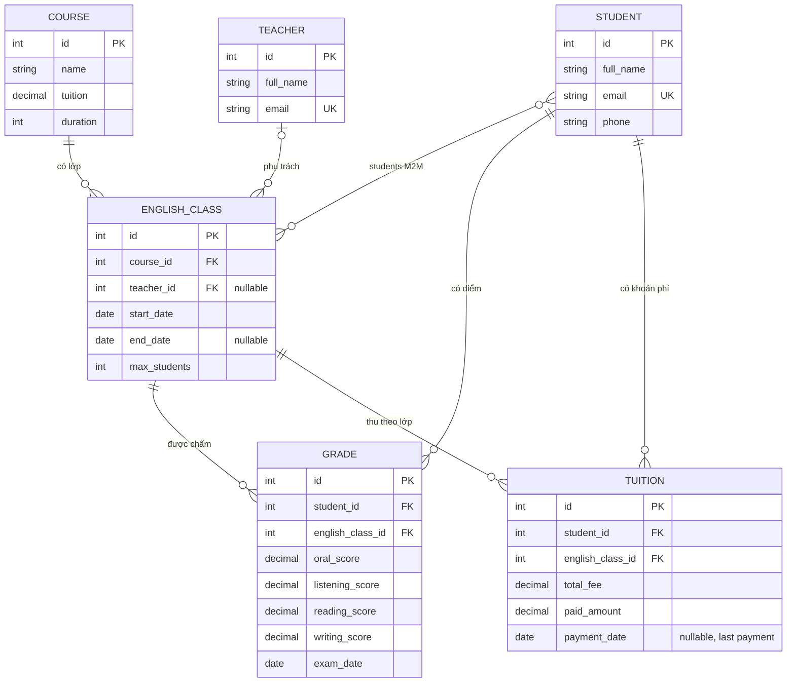

# ERD hiện trạng: học viên, khóa học, lớp, điểm và học phí

Phạm vi: đối chiếu trực tiếp các model hiện có trong `core/models.py`. Đây là mô tả hiện trạng, chưa phải thiết kế đích và chưa thay đổi schema.

## Điểm cần quyết định trước khi thiết kế lại

1. **Ghi danh chưa có model riêng:** `EnglishClass.students` là quan hệ nhiều-nhiều trực tiếp, nên hiện chưa có chỗ lưu ngày ghi danh, trạng thái, lịch sử chuyển/nghỉ/bảo lưu hoặc học phí chốt tại thời điểm ghi danh.
2. **Điểm chưa có loại/lần đánh giá:** mỗi bản ghi `Grade` có bốn điểm kỹ năng và ngày thi, nhưng chưa có tên bài kiểm tra/kỳ học; chưa thấy ràng buộc chống bản ghi trùng theo học viên, lớp và kỳ.
3. **Học phí chưa có sổ giao dịch:** `Tuition.paid_amount` và `payment_date` chỉ thể hiện tổng đã thu và ngày gần nhất; không biểu diễn được nhiều lần thu, mã phiếu, hoàn/điều chỉnh hay người ghi nhận.
4. **Phí khóa học có thể thay đổi:** `Course.tuition` là giá hiện tại của khóa; cần quyết định có lưu giá áp dụng riêng cho từng lần ghi danh hay không để thay đổi giá khóa không làm sai khoản phí cũ.
5. **Một số quy tắc hiện nằm ở property:** `Grade.average_score`, `Grade.classification`, `Tuition.remaining_amount` và `Tuition.payment_status` được tính trong Python; cần chốt công thức và quy tắc làm tròn trước khi chuẩn hóa.
6. **Cần kiểm tra dữ liệu thực trước migration:** xác định DB đang dùng, số lượng bản ghi, quan hệ mồ côi/trùng và khả năng sao lưu. Không xóa hay di trú dữ liệu từ bản ghi demo này.

## Quan hệ hiện tại, tóm tắt

- Một khóa học có nhiều lớp; mỗi lớp thuộc đúng một khóa học.
- Một giáo viên có thể phụ trách nhiều lớp; lớp có thể chưa được gán giáo viên.
- Học viên và lớp là quan hệ nhiều-nhiều trực tiếp.
- Điểm và học phí đều tham chiếu một học viên và một lớp.
- Chưa chạy migration hay sửa model khi lập bản ERD này.
