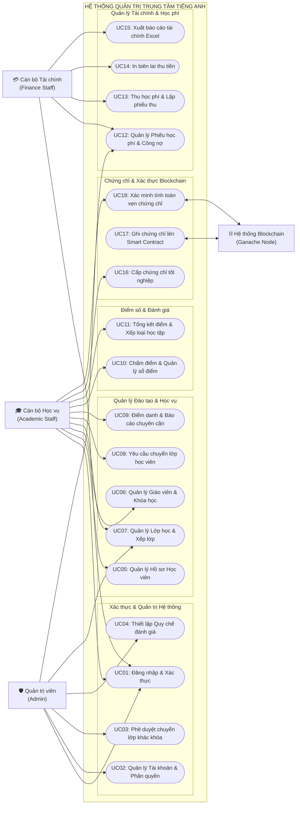
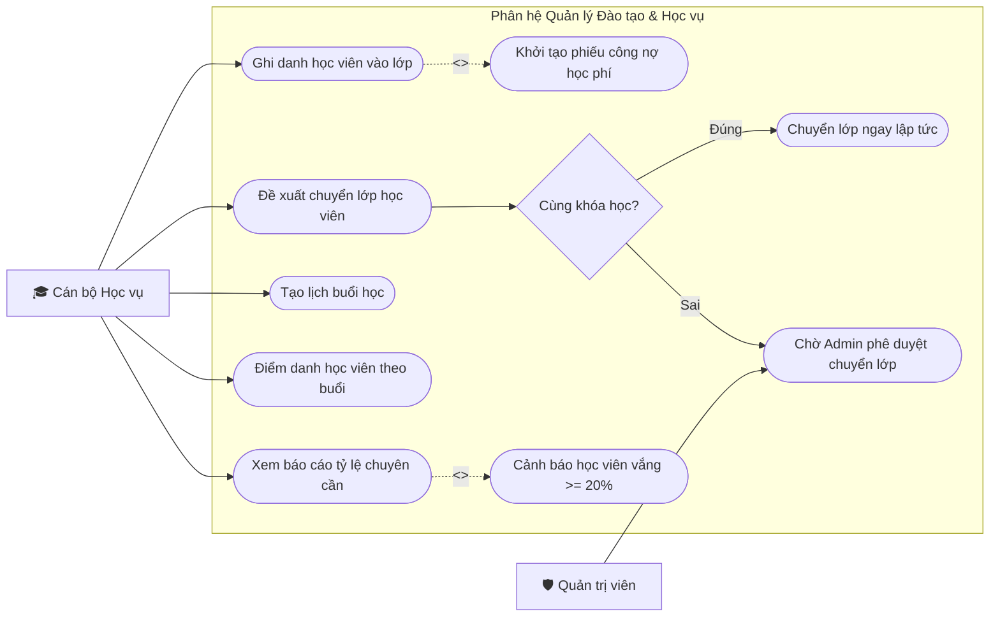
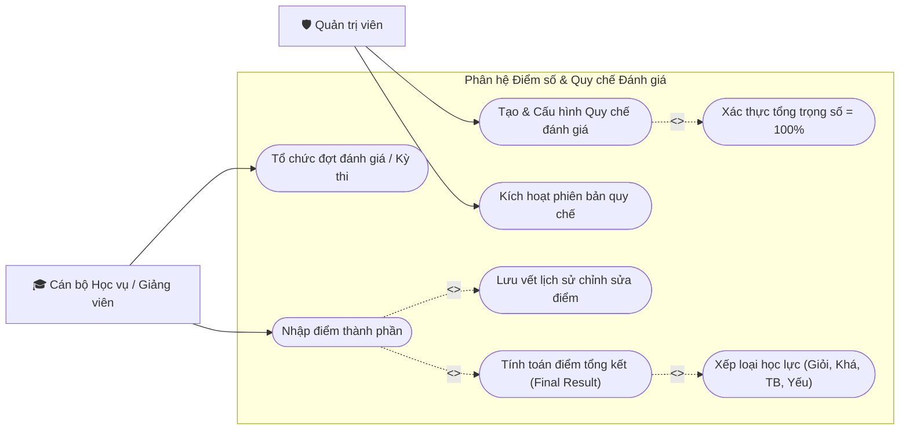
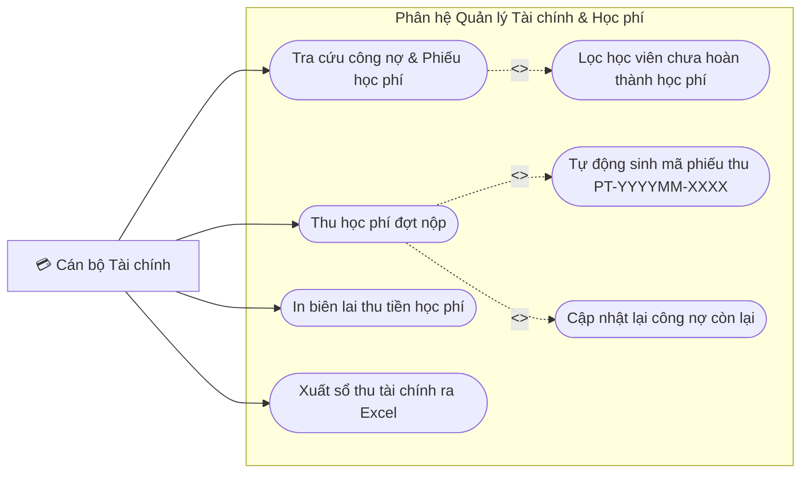
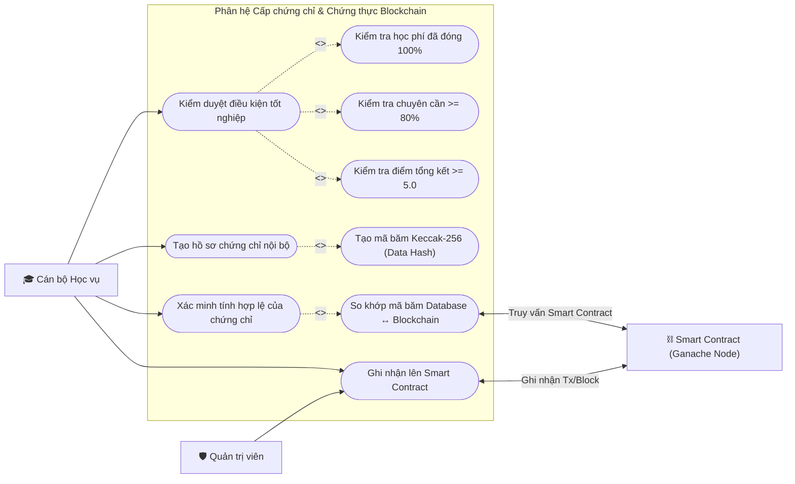
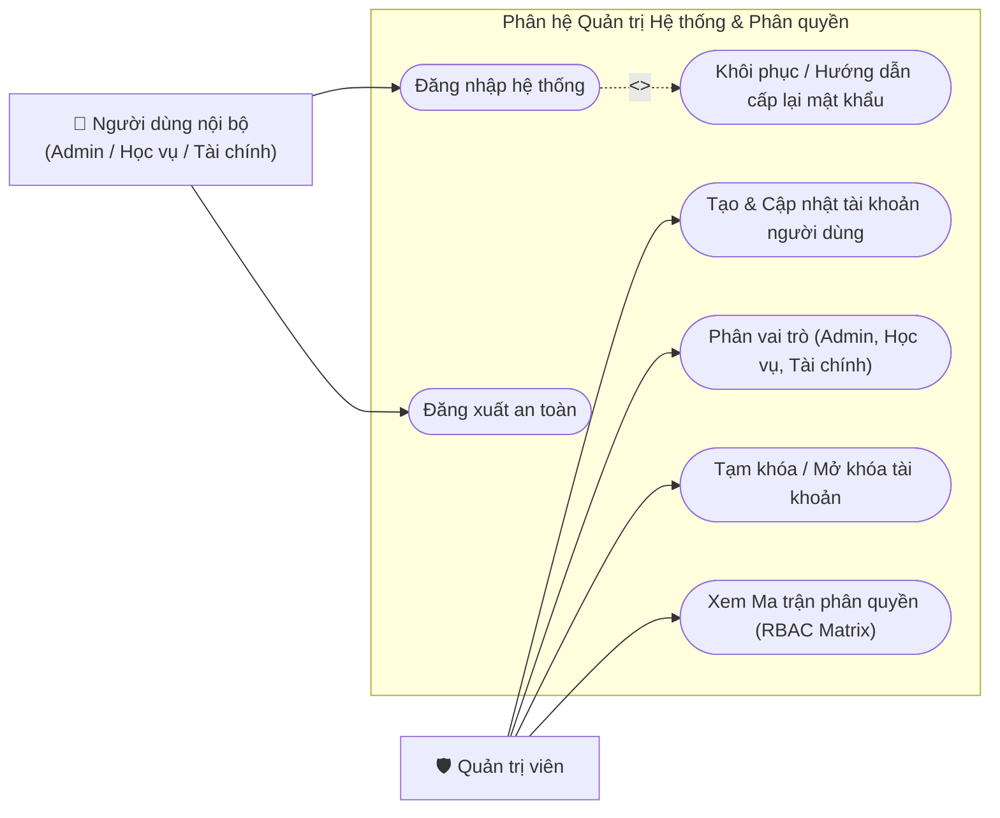

# TÀI LIỆU ĐẶC TẢ VÀ SƠ ĐỒ USE CASE HỆ THỐNG
**Dự án:** Ứng dụng Quản trị Trung tâm Tiếng Anh (`APP-Trung-Tam-Tieng-Anh`)  
**Tài liệu:** Báo cáo Phân tích Yêu cầu & Thiết kế Hệ thống  
**Công cụ thể hiện:** Mermaid Diagram (Hỗ trợ Markdown Preview, Git Version Control, Notion)  

---

## I. XÁC ĐỊNH DANH SÁCH TÁC NHÂN (ACTORS)

Hệ thống quản lý trung tâm tiếng Anh bao gồm 3 nhóm người dùng nội bộ (theo mô hình Phân quyền Vai trò - RBAC) và 1 tác nhân hệ thống bên ngoài:

| STT | Tác nhân (Actor) | Phân loại | Mô tả vai trò và trách nhiệm |
|:---:|---|:---:|---|
| **1** | **Quản trị viên** *(Admin)* | Primary Actor | Người nắm toàn quyền hệ thống: quản lý tài khoản người dùng, phân vai trò (Admin, Học vụ, Tài chính), phê duyệt chuyển lớp khác khóa học, thiết lập quy chế đánh giá học tập, lưu trữ hoặc xóa dữ liệu cốt lõi. |
| **2** | **Cán bộ Học vụ** *(Academic Staff)* | Primary Actor | Chịu trách nhiệm toàn bộ quy trình đào tạo: quản lý hồ sơ học viên, giáo viên, khóa học, lớp học; xếp lớp & ghi danh; tạo lịch buổi học & thực hiện điểm danh; tổ chức thi & nhập điểm số; đề xuất chuyển lớp; cấp chứng chỉ tốt nghiệp. |
| **3** | **Cán bộ Tài chính** *(Finance Staff)* | Primary Actor | Chịu trách nhiệm dòng tiền và kế toán: theo dõi công nợ học phí; lập phiếu thu tiền học phí theo từng đợt; in biên lai thanh toán; xuất báo cáo học phí ra định dạng Excel. |
| **4** | **Hệ thống Blockchain** *(Smart Contract Node)* | Secondary / System Actor | Mạng lưới Ethereum/Ganache cục bộ tiếp nhận mã băm (data hash) của chứng chỉ, đóng dấu khối (Block Number/TxHash) và cung cấp cơ chế đối chiếu tính toàn vẹn của chứng chỉ trong thời gian thực. |

---

## II. SƠ ĐỒ USE CASE TỔNG THỂ (SYSTEM OVERVIEW)

*Hình 2.1 – Sơ đồ Use Case tổng thể toàn hệ thống quản trị trung tâm tiếng Anh*

---

## III. SƠ ĐỒ USE CASE PHÂN RÃ CHI TIẾT THEO PHÂN HỆ

### 1. Phân hệ Quản lý Đào tạo & Xếp lớp (Academic Management)
Phân hệ đảm nhiệm vòng đời của học viên từ khi nhập học, xếp lớp, điểm danh hàng ngày cho đến chuyển lớp:

*Hình 2.2 – Sơ đồ Use Case chi tiết Phân hệ Quản lý Đào tạo, Xếp lớp & Điểm danh*

---

### 2. Phân hệ Điểm số & Đánh giá theo Quy chế (Grading & Assessment)
Hệ thống cho phép cấu hình quy chế linh hoạt (phiên bản, trọng số từng kỹ năng) và tự động tính điểm tổng kết:

*Hình 2.3 – Sơ đồ Use Case chi tiết Phân hệ Điểm số & Đánh giá theo quy chế*

---

### 3. Phân hệ Quản lý Tài chính & Thu học phí (Finance Management)
Quản lý công nợ, cho phép học viên trả góp học phí theo từng đợt và xuất biên lai tài chính:

*Hình 2.4 – Sơ đồ Use Case chi tiết Phân hệ Tài chính & Lịch sử Thu tiền*

---

### 4. Phân hệ Cấp Chứng chỉ & Xác thực Blockchain (Blockchain Certification)
Cổng kiểm duyệt đầu ra trước khi cấp chứng chỉ và đối chiếu bằng chứng mật mã trên mạng Blockchain:

*Hình 2.5 – Sơ đồ Use Case chi tiết Phân hệ Cấp chứng chỉ & Xác thực Blockchain*

---

### 5. Phân hệ Quản trị Hệ thống & Phân quyền (System Administration)
Quản lý bảo mật đăng nhập và quyền truy cập đặc quyền tối thiểu:

*Hình 2.6 – Sơ đồ Use Case chi tiết Phân hệ Quản trị Tài khoản & Phân quyền RBAC*

---

## IV. BẢNG ĐẶC TẢ CHI TIẾT CÁC USE CASE CỐT LÕI (USE CASE SPECIFICATIONS)

### 1. Đặc tả Use Case: Cấp chứng chỉ tốt nghiệp & Băm Blockchain (UC16 & UC17)
- **Tên Use Case:** Cấp chứng chỉ tốt nghiệp và Lưu trữ chứng thực Blockchain.
- **Tác nhân chính:** Cán bộ Học vụ, Quản trị viên.
- **Tác nhân hỗ trợ:** Hệ thống Smart Contract Ethereum / Ganache.
- **Tiền điều kiện (Pre-conditions):**
  1. Người dùng đã đăng nhập với vai trò Học vụ hoặc Admin.
  2. Lớp học đã hoàn tất chương trình đào tạo.
  3. Node Blockchain Ganache đang hoạt động (kết nối HTTP RPC thành công).
- **Luồng sự kiện chính (Main Flow):**
  1. Học vụ chọn Lớp học cần cấp chứng chỉ.
  2. Hệ thống duyệt danh sách học viên và kiểm tra 3 điều kiện:
     - Học phí: `remaining_amount == 0`.
     - Chuyên cần: tỷ lệ tham gia buổi học `>= 80%`.
     - Điểm tổng kết: `final_score >= 5.0`.
  3. Hệ thống hiển thị danh sách học viên đủ điều kiện kèm điểm và xếp loại gợi ý.
  4. Học vụ chọn học viên, kiểm tra ngày cấp và tích chọn "Ghi nhận lên Blockchain".
  5. Học vụ nhấn "Xác nhận cấp chứng chỉ".
  6. Hệ thống tạo bản ghi `Certificate`, sinh mã chứng chỉ duy nhất (`CERT-XXXXXXXXXXXX`), tạo mã băm `keccak256` chuẩn hóa dữ liệu.
  7. Hệ thống gửi giao dịch `issueCertificate` tới Smart Contract trên Blockchain thông qua tài khoản Owner Ganache.
  8. Hệ thống nhận Transaction Hash và Block Number, lưu trạng thái `issued` vào Database.
  9. Hệ thống thông báo thành công cho người dùng.
- **Luồng ngoại lệ (Alternative / Exception Flows):**
  - *Học viên còn nợ học phí:* Hệ thống chặn cấp, hiển thị thông báo "Học viên còn nợ học phí, vui lòng hoàn tất công nợ trước khi cấp chứng chỉ".
  - *Mạng Blockchain bị ngắt kết nối:* Hệ thống lưu chứng chỉ vào CSDL với trạng thái `pending`, thông báo "Đã cấp chứng chỉ nội bộ. Mạng Blockchain đang tắt, vui lòng phát hành lên sổ cái sau".
- **Hậu điều kiện (Post-conditions):** Bản ghi chứng chỉ được lưu an toàn trong MySQL/SQLite và một bản băm bảo chứng bất biến được khắc lên Blockchain.

---

### 2. Đặc tả Use Case: Thu học phí & Ghi nhận giao dịch (UC13)
- **Tên Use Case:** Thu học phí từng đợt & Lập phiếu thu.
- **Tác nhân chính:** Cán bộ Tài chính.
- **Tiền điều kiện:** Học viên đã được xếp vào lớp học và có bản ghi `Tuition` trong hệ thống.
- **Luồng sự kiện chính (Main Flow):**
  1. Cán bộ tài chính tìm kiếm học viên hoặc lớp học cần thu tiền.
  2. Hệ thống hiển thị số tiền học phí gốc, số tiền đã đóng lũy kế và số tiền còn nợ.
  3. Tài chính chọn "Thu học phí bổ sung" (`tuition_payment_add`).
  4. Tài chính nhập số tiền đợt này nộp (VNĐ), phương thức thanh toán (Tiền mặt / Chuyển khoản / Thẻ) và ghi chú.
  5. Hệ thống kiểm tra: số tiền nộp `> 0` và `<= số tiền còn nợ`.
  6. Tài chính nhấn "Xác nhận thu tiền".
  7. Hệ thống tự động tạo mã biên lai duy nhất `PT-YYYYMM-XXXXXX` vào bảng `PaymentTransaction`, tự động cập nhật lại `Tuition.paid_amount` và ngày thanh toán gần nhất.
  8. Hệ thống điều hướng về danh sách kèm thông báo thu thành công và cung cấp nút "In biên lai".
- **Luồng ngoại lệ:**
  - *Số tiền nộp vượt quá công nợ:* Hệ thống báo lỗi "Số tiền nộp không được lớn hơn số tiền còn nợ của học viên".

---

## V. CÁC QUY TẮC THIẾT KẾ ĐÃ ÁP DỤNG TRONG TÀI LIỆU NÀY
1. **Không nhầm Use Case với chức năng vi mô giao diện:** Toàn bộ Use Case đều đặt tên theo mục tiêu nghiệp vụ của tác nhân (ví dụ: "Thu học phí", "Ghi danh học viên", "Cấp chứng chỉ"), không sử dụng tên nút thao tác như "Bấm tìm kiếm", "Click dropdown".
2. **Đầy đủ tác nhân con người và tác nhân hệ sinh thái:** Làm rõ 3 nhóm vai trò người dùng (Admin, Học vụ, Tài chính) và tác nhân Smart Contract Node bên thứ ba.
3. **Phân rã theo phân hệ chức năng:** Sử dụng `subgraph` đóng gói rõ phạm vi từng phân hệ, sơ đồ đi từ tổng thể (Hình 2.1) đến chi tiết từng module (Hình 2.2 - 2.6).
4. **Chuẩn hóa quan hệ phụ thuộc:** Thể hiện rõ quan hệ `<<include>>` (bắt buộc phải chạy kèm) và `<<extend>>` (mở rộng / rẽ nhánh khi thỏa điều kiện).
5. **Khả năng Version Control:** Toàn bộ mã nguồn sơ đồ được lưu dưới dạng Mermaid text-based trong tệp Markdown, cho phép Git theo dõi từng thay đổi logic theo thời gian thực.

