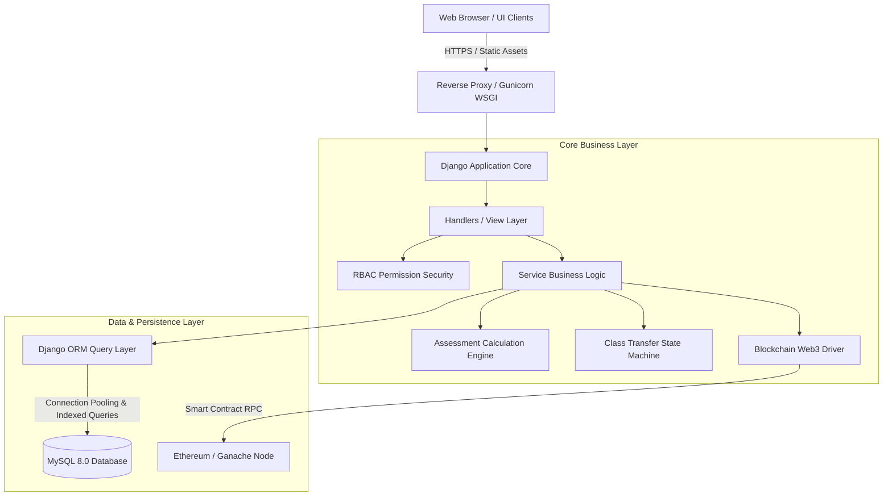
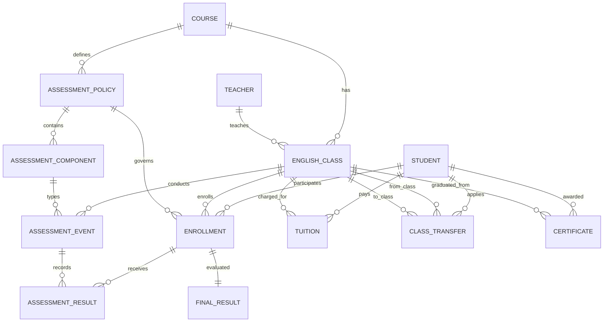
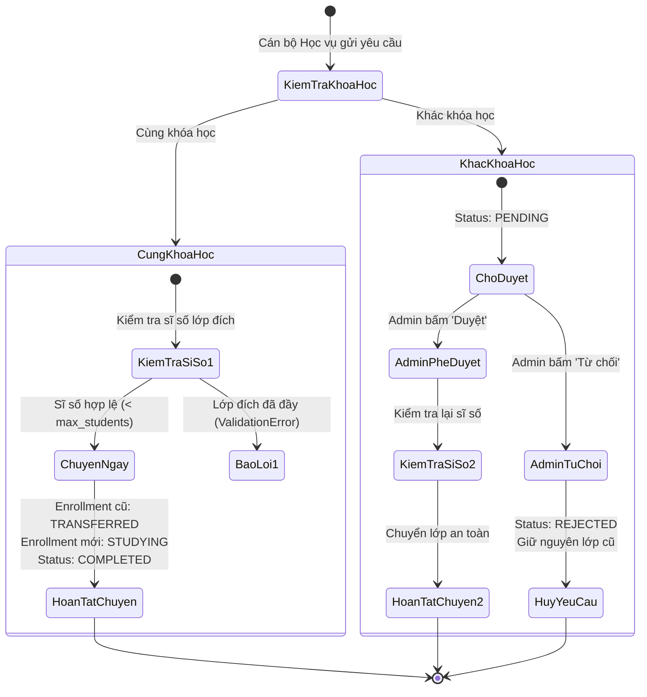

# TÀI LIỆU KIẾN TRÚC HỆ THỐNG (SYSTEM ARCHITECTURE)
**Dự án:** Hệ thống Quản trị Trung tâm Tiếng Anh (English Center Management System)  
**Phiên bản:** v1.0.0 Enterprise  
**Cơ sở dữ liệu:** MySQL 8.0 (InnoDB, `utf8mb4_unicode_ci`)  
**Backend:** Python 3.12 / Django 6.1 LTS  
**Blockchain:** Ethereum / Ganache Web3 Proof-of-Certificate  

---

## 1. TỔNG QUAN KIẾN TRÚC TỔNG THỂ

Hệ thống được xây dựng theo mô hình **Monolithic Modular 3 lớp (3-Tier Layered Architecture)** chuẩn doanh nghiệp, tối ưu hóa cho độ tin cậy, bảo mật và tốc độ phản hồi cao:

---

## 2. THIẾT KẾ MÔ HÌNH CƠ SỞ DỮ LIỆU (DATABASE SCHEMA)

Cơ sở dữ liệu được chuẩn hóa ở cấp độ **3NF (Third Normal Form)**, bảo toàn tính toàn vẹn tham chiếu thông qua các ràng buộc khóa ngoại `PROTECT` và `CASCADE` có kiểm soát.

### Các bảng dữ liệu nòng cốt và chiến lược Đánh chỉ mục (Indexing Strategy)

| Tên Bảng | Vai trò | Khóa chính & Ràng buộc | Chỉ mục tăng tốc (`db_index=True`) |
| :--- | :--- | :--- | :--- |
| **`core_student`** | Hồ sơ học viên | `id`, Unique: `email` | `full_name`, `phone`, `created_at`, `is_active` |
| **`core_course`** | Khóa học đào tạo | `id` | `is_active` |
| **`core_teacher`** | Đội ngũ giảng viên | `id`, Unique: `email` | `is_active` |
| **`core_englishclass`** | Lớp học thực tế | `id`, FK: `course_id`, `teacher_id` | `start_date`, `is_active` |
| **`core_enrollment`** | Ghi danh học viên vào lớp | `id`, Unique: `(student_id, english_class_id)` | `status`, `enrolled_at` |
| **`core_assessmentpolicy`** | Quy chế tính điểm | `id`, FK: `course_id` | `status` |
| **`core_assessmentcomponent`** | Cột điểm & tỷ trọng (%) | `id`, Unique: `(policy_id, name)` | `policy_id` |
| **`core_assessmentevent`** | Đợt kiểm tra / Bài thi | `id`, FK: `english_class_id`, `component_id` | `assessment_date` |
| **`core_assessmentresult`** | Điểm từng lần thi của học viên | `id`, FK: `enrollment_id`, `event_id` | `status` |
| **`core_finalresult`** | Kết quả tổng kết & xếp loại | `id`, Unique: `enrollment_id` | `status` |
| **`core_classtransfer`** | Yêu cầu chuyển lớp | `id`, FK: `student_id`, `source_class_id` | `status`, `requested_at` |
| **`core_tuition`** | Học phí & công nợ | `id`, FK: `student_id`, `english_class_id` | `payment_date`, `created_at` |
| **`core_certificate`** | Chứng chỉ tốt nghiệp | `id`, Unique: `certificate_code` | `issue_date`, `blockchain_status` |

---

## 3. MA TRẬN PHÂN QUYỀN TRUY CẬP (RBAC MATRIX)

Hệ thống phân chia 4 vai trò rõ rệt để ngăn chặn truy cập trái phép và bảo vệ dữ liệu kế toán, điểm số:

| Phân hệ / Chức năng | Khách (Chưa Login) | Giáo Vụ (`Hoc_Vu`) | Tài Chính (`Tai_Chinh`) | Quản Trị Viên (`Admin`) |
| :--- | :---: | :---: | :---: | :---: |
| **Đăng nhập & Xem Dashboard** | ❌ Chuyển Login | ✅ Chỉ số đào tạo | ✅ Chỉ số doanh thu | ✅ Toàn quyền xem |
| **Quản lý Học viên & Lớp học** | ❌ Chặn 403 | ✅ Thêm / Sửa / Lưu trữ | ❌ Chặn 403 | ✅ Toàn quyền |
| **Ghi danh & Đăng ký lớp** | ❌ Chặn 403 | ✅ Thực hiện | ❌ Chặn 403 | ✅ Toàn quyền |
| **Chuyển lớp (Cùng khóa học)** | ❌ Chặn 403 | ✅ Chuyển ngay lập tức | ❌ Chặn 403 | ✅ Toàn quyền |
| **Chuyển lớp (Khác khóa học)** | ❌ Chặn 403 | ⚠️ Gửi đơn chờ duyệt | ❌ Chặn 403 | ✅ Phê duyệt đơn |
| **Nhập điểm & Đánh giá kết quả** | ❌ Chặn 403 | ✅ Nhập & Tính điểm | ❌ Chặn 403 | ✅ Toàn quyền |
| **Quản lý Học phí & Thu tiền** | ❌ Chặn 403 | ❌ Chặn 403 | ✅ Tạo & Thu tiền | ✅ Toàn quyền |
| **Xuất Biên lai A5 & Báo cáo Excel** | ❌ Chặn 403 | ❌ Chặn 403 | ✅ In & Xuất file | ✅ Toàn quyền |
| **Cấp Chứng chỉ lên Blockchain** | ❌ Chặn 403 | ❌ Chặn 403 | ❌ Chặn 403 | ✅ Ký & Ghi Block |
| **Tra cứu chứng chỉ công khai** | ✅ Tra cứu mã hash | ✅ Tra cứu | ✅ Tra cứu | ✅ Tra cứu |

---

## 4. QUY TRÌNH CHUYỂN LỚP (STATE MACHINE)

---

## 5. TÍCH HỢP BLOCKCHAIN & CƠ CHẾ PHÒNG VỆ (DEFENSIVE PROOF-OF-CERTIFICATE)

1. **Chuẩn mã hóa**: Chứng chỉ tốt nghiệp được băm mã thông tin bằng thuật toán `Keccak-256` hoặc `SHA-256` kết hợp:
   $$\text{Hash} = \text{Hash256}(\text{Mã HV} + \text{Mã Lớp} + \text{Điểm} + \text{Ngày cấp} + \text{Secret Salt})$$
2. **Ký giao dịch Smart Contract**: Giao dịch gửi lên mạng Ethereum/Ganache lưu trữ vĩnh viễn cặp `(certificate_code, data_hash)` vào Smart Contract.
3. **Cơ chế phòng thủ Circuit Breaker**: Khi mạng Blockchain gặp sự cố (Ganache offline, nghẽn gas):
   - Hệ thống tự động ghi nhận trạng thái cục bộ `pending`.
   - Trang web không bao giờ bị Crash hay treo 500 error.
   - Khi mạng thông suốt, Admin có thể bấm "Cấp lại" bằng 1 click.
