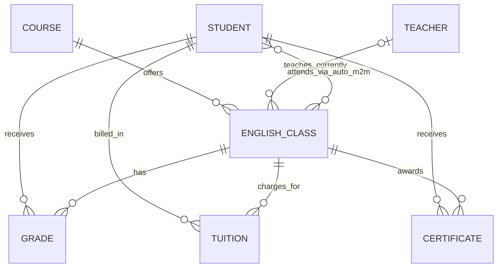
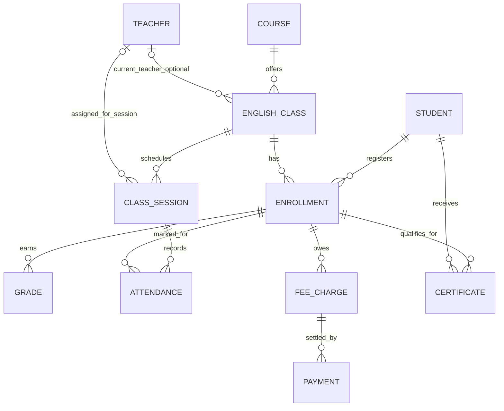

# Báo cáo kiểm toán thiết kế cơ sở dữ liệu

**Ngày kiểm tra:** 17/10/2026  
**Phạm vi:** mã nguồn Django, models, migrations, cấu hình, admin và các handler hiện có.  
**Phương pháp:** rà soát tĩnh mã nguồn; không chạy migration, không sửa model/cấu hình/dữ liệu và không kết nối vào PostgreSQL.

## 1. Tóm tắt

Dự án có 7 model nghiệp vụ: `Student`, `Course`, `Teacher`, `EnglishClass`, `Grade`, `Tuition`, `Certificate`. Chúng bao phủ một phần chức năng quản lý học viên, khóa học, lớp, giáo viên, điểm, học phí dạng số dư tổng hợp và chứng chỉ. Các migration `core.0001` đến `core.0007` tạo những model này.

Đây là cấu trúc phù hợp cho bản demo/MVP ban đầu, nhưng chưa đủ an toàn cho vận hành thực tế nếu cần quản lý lịch sử đăng ký/chuyển lớp, buổi học và điểm danh, nhiều lần kiểm tra, giao dịch thu/hoàn tiền, phân công giáo viên theo thời gian, người dùng có tài khoản và nhật ký chỉnh sửa.

Trong cấu hình hiện tại Django **mặc định dùng SQLite**. `config/settings.py` chỉ chọn PostgreSQL khi biến môi trường `DB_ENGINE=postgresql` hoặc `postgres` được đặt. Tại lần kiểm tra trước đó trong terminal, biến `DB_ENGINE` không được đặt; `db.sqlite3` tồn tại nhưng có kích thước 0 byte; `psycopg` đã có trong virtualenv. Vì vậy chưa thể xác nhận ứng dụng đã kết nối hoặc đã tạo schema trên PostgreSQL. Không có căn cứ để mô tả cấu trúc database PostgreSQL thực tế.

**Khuyến nghị:** giữ các model hiện tại làm nền, chỉnh các ràng buộc và quan hệ có rủi ro trước; thêm các thực thể nghiệp vụ theo nhu cầu đã xác nhận. Không thiết kế lại toàn bộ và không xóa dữ liệu/bảng. Ưu tiên cao nhất là ràng buộc quan hệ điểm/đăng ký, tách khoản phải thu khỏi các lần thanh toán, và xác định mô hình lớp học theo buổi.

## 2. Công nghệ và bằng chứng

- Django 6.1.2 được khai báo trong `requirements.txt`.
- `config/settings.py` cấu hình SQLite làm mặc định và PostgreSQL qua `DB_ENGINE` cùng `DB_NAME`, `DB_USER`, `DB_PASSWORD`, `DB_HOST`, `DB_PORT`.
- `psycopg` có trong virtualenv tại lúc kiểm tra; `psycopg2` không có. File `requirements.txt` chưa khai báo psycopg, do đó môi trường cài mới chưa được bảo đảm có driver PostgreSQL.
- Có migration `core/migrations/0001_initial.py` đến `0007_certificate.py`. Ở lần kiểm tra trước, `showmigrations --plan` cho thấy toàn bộ migration Django và core chưa được áp dụng trên kết nối mà terminal đang dùng. Do môi trường đó mặc định là SQLite, đây không phải bằng chứng về trạng thái PostgreSQL.
- `db.sqlite3` có kích thước 0 byte tại thời điểm kiểm tra; không thể introspect schema hay dữ liệu từ file này.
- PostgreSQL service `postgresql-x64-18` được người dùng xác nhận đang chạy, nhưng service chạy không chứng minh ứng dụng đã kết nối vào database nào.

## 3. Bảng/model hiện có

Các tên bảng dưới đây là tên mặc định Django (`<app_label>_<model>`), trừ bảng trung gian M2M được Django sinh tự động.

| Model / bảng | Trường chính | Quan hệ / ghi chú |
|---|---|---|
| `Student` / `core_student` | `id` BigAutoField PK; `full_name` varchar(100); `email` email(254), unique; `phone` varchar(15); `date_of_birth` date nullable; `address` text; `created_at` datetime | N-N với `EnglishClass` qua bảng trung gian tự động; 1-N với `Grade`, `Tuition`, `Certificate` |
| `Course` / `core_course` | `id`; `name` varchar(200); `description` text; `tuition` decimal(10,0), default 0; `duration` positive integer, default 3 | 1-N với `EnglishClass`; lớp dùng `PROTECT` |
| `Teacher` / `core_teacher` | `id`; `full_name` varchar(100); `email` email unique; `phone` varchar(15); `specialization` varchar(100); `address` text; `created_at` datetime | 1-N với lớp qua `EnglishClass.teacher`, nhưng hiện chỉ giữ một giáo viên hiện tại trên lớp |
| `EnglishClass` / `core_englishclass` | `id`; `name`; `course_id` FK; `teacher_name` varchar(100) cũ; `teacher_id` FK nullable; `start_date` date; `end_date` date nullable; `max_students` positive integer default 20 | N-1 `Course`; N-1 tùy chọn `Teacher`; N-N `Student`; trường tên giáo viên cũ trùng ý nghĩa một phần với FK mới |
| bảng trung gian M2M / `core_englishclass_students` (mặc định) | khóa chính tự sinh; `englishclass_id`; `student_id` | Django tạo tự động cho `EnglishClass.students`; mặc định có unique cặp FK |
| `Grade` / `core_grade` | `id`; `student_id`; `english_class_id`; 4 điểm decimal(4,2), default 0; `exam_date`; `note`; `created_at` | N-1 tới học viên và lớp; `average_score` và `classification` là property tính từ 4 điểm |
| `Tuition` / `core_tuition` | `id`; `student_id`; `english_class_id`; `total_fee` decimal(12,0); `paid_amount` decimal(12,0); `payment_date` nullable; `note`; `created_at` | N-1 tới học viên/lớp; `remaining_amount` và `payment_status` là property |
| `Certificate` / `core_certificate` | `id`; `certificate_code` varchar(50), unique; `student_id`; `english_class_id`; `issue_date`; `score` decimal(4,2); `classification`; `data_hash` varchar(66); `transaction_hash` varchar(66); `block_number` positive bigint nullable; `blockchain_status` varchar(20); `created_at` | N-1 tới học viên/lớp; `PROTECT`; mã chứng chỉ sinh UUID rút gọn |

Ngoài các bảng core, khi áp dụng migration Django sẽ có bảng hệ thống như `auth_user`, `auth_group`, `auth_permission`, `django_content_type`, `django_session`, `django_admin_log` và `django_migrations`. Bảng M2M của `EnglishClass.students` được Django tạo từ field, không có model nghiệp vụ khai báo riêng. Chưa thấy custom user model. Chưa thấy model nhật ký nghiệp vụ riêng.

## 4. Đánh giá theo bảng

### `Student` — HỢP LÝ, cần làm rõ nghiệp vụ

Model lưu hồ sơ liên hệ cơ bản, email unique và ngày sinh tùy chọn là hợp lý. `phone` chưa unique nên có thể trùng; việc có cho phép nhiều học viên dùng chung số điện thoại hay không cần xác nhận. Email có thể không phải định danh bắt buộc trong thực tế, nhưng hiện tại là bắt buộc và duy nhất: cần xác nhận quy tắc với trung tâm. `address` dạng text phù hợp nếu chỉ cần địa chỉ tự do; không cần tách địa chỉ nếu chưa có báo cáo theo tỉnh/thành.

Thiếu trạng thái hồ sơ/học tập (đang học, bảo lưu, đã nghỉ) nếu các màn hình cần quản lý vòng đời. Không nên thêm trước khi chốt quy trình và trạng thái hợp lệ.

### `Course` — HỢP LÝ ở MVP, thiếu mô hình chương trình nếu cần

`tuition` trên khóa học có thể là giá niêm yết mặc định; đây không trùng sai với số phải thu thực tế nếu mức giảm giá/giá tại thời điểm đăng ký được lưu ở enrollment hoặc khoản phải thu. `duration` chỉ tính tháng, chưa nói rõ giờ học/số buổi/đơn vị. `tuition` cho phép 0 và không có CheckConstraint; dữ liệu âm hiện bị ngăn bởi DecimalField? Django không tự bảo đảm giá trị lớn hơn hoặc bằng 0 tại DB nếu không thêm constraint.

Chưa có cấp độ, giáo trình, mục tiêu đầu ra hay phiên bản chương trình. Chỉ thêm nếu nghiệp vụ cần quản lý nội dung đào tạo có cấu trúc.

### `Teacher` — HỢP LÝ ở MVP, thiếu liên kết tài khoản/lịch sử

Hồ sơ giáo viên độc lập với tài khoản đăng nhập là hợp lý. Email unique phù hợp nếu mọi giáo viên phải có email riêng. Chưa có trạng thái làm việc, thông tin hợp đồng hoặc lịch khả dụng; chỉ cần bổ sung theo phạm vi nhân sự đã xác nhận.

### `EnglishClass` — SAI THIẾT KẾ / RỦI RO dữ liệu (High)

- `teacher` là FK tới một giáo viên, không thể lưu lịch sử phân công hoặc nhiều giáo viên cùng dạy lớp.
- `teacher_name` vẫn tồn tại song song với FK `teacher`. Migration 0004 đã chủ ý đổi tên thành “Tên giáo viên cũ”; giữ để tương thích có thể hợp lý trong giai đoạn chuyển tiếp nhưng lâu dài dễ không nhất quán nếu code tiếp tục ghi cả hai.
- `students` M2M chỉ lưu thành viên hiện tại, không có ngày đăng ký, trạng thái, ngày rời lớp, mức phí/giảm giá đã chốt hoặc lịch sử chuyển lớp. Xóa khỏi lớp làm mất thông tin thành viên hiện tại mà không lưu lý do/lịch sử.
- Không có constraint `end_date >= start_date`; `max_students` cho phép 0. Nhiều lớp có thể trùng lịch vì model chưa lưu lịch buổi học/phòng.
- Chưa có unique theo tên lớp và kỳ học; chỉ thêm nếu quy tắc đặt mã/tên yêu cầu.

Không xóa `teacher_name` trực tiếp. Đối chiếu giá trị hiện có với `teacher` qua data migration có kiểm tra, sau đó ngừng ghi field cũ và chỉ loại bỏ ở một release sau khi xác nhận không còn dùng.

### `Grade` — RỦI RO dữ liệu (High)

- Không có ràng buộc đảm bảo `student` là thành viên của `english_class`. Có thể ghi điểm cho học viên chưa đăng ký lớp hoặc ghi sai lớp.
- 4 điểm `DecimalField(max_digits=4, decimal_places=2)` có thể lưu số âm hoặc lớn hơn thang 10; chưa có CheckConstraint cho miền điểm.
- Chỉ có 4 kỹ năng cố định; có thể phù hợp với bài đánh giá IELTS/4 kỹ năng, nhưng nếu có nhiều bài kiểm tra/môn/loại đánh giá thì cần thực thể Assessment riêng thay vì thêm cột liên tục.
- Không có mã/loại bài thi, kỳ thi hoặc phiên bản điểm. Một học viên có thể có nhiều bản ghi cùng ngày, điều này có thể hợp lệ; không thêm unique tùy tiện.
- `average_score` là trung bình cộng đơn giản; chưa có trọng số hoặc quy tắc xử lý điểm thiếu (fields default 0 biến “chưa chấm” thành điểm 0). Cần BA xác nhận cách tính.
- `CASCADE` từ học viên/lớp sẽ xóa lịch sử điểm nếu bản ghi cha bị xóa. Cần cân nhắc lưu trữ/soft delete hoặc `PROTECT` khi đã phát sinh dữ liệu học tập.

### `Tuition` — SAI THIẾT KẾ / RỦI RO dữ liệu (High)

Model gộp khoản phải thu và số tiền đã thu vào một dòng. `paid_amount` không cho biết có bao nhiêu lần thanh toán, ngày/số tham chiếu/phương thức/người nhận mỗi lần, hoặc hoàn tiền. Mỗi lần thu có thể ghi đè tổng tiền đã đóng và `payment_date` chỉ là ngày gần nhất, nên không thể đối soát hay kiểm toán dòng tiền đáng tin cậy.

`student_id` và `english_class_id` không được ràng buộc rằng học viên thuộc lớp đó. Không có CheckConstraint cho `total_fee >= 0`, `paid_amount >= 0`, hoặc chính sách cho `paid_amount > total_fee`. `CASCADE` khi xóa học viên xóa hồ sơ học phí; lớp dùng `PROTECT`. Với dữ liệu tài chính, xóa vật lý thường không phù hợp.

Đề xuất tách `Enrollment` (mức học phí phải thu tại thời điểm đăng ký) và `Payment`/`Refund` (mỗi giao dịch một bản ghi). Không chuyển `paid_amount` sang payment mới bằng suy đoán; cần đối chiếu dữ liệu từng bản ghi và tạo số dư mở đầu có nguồn gốc nếu triển khai.

### `Certificate` — HỢP LÝ cho MVP; cần ràng buộc tính nhất quán

Mã chứng chỉ unique và `PROTECT` giúp giữ liên kết lịch sử. Hash, transaction hash, block number và trạng thái là phù hợp khi blockchain thực sự được dùng; nếu chưa kích hoạt blockchain, các trường có thể để trống theo trạng thái pending. Một số nguyên liệu chứng chỉ đang lưu đồng thời `score`/`classification` tại thời điểm cấp; đây là snapshot lịch sử hợp lý, không nên bỏ vì có thể khác kết quả hiện hành sau chỉnh sửa điểm.

Chưa có constraint xác nhận học viên đã học lớp, đạt điều kiện cấp, hoặc không cấp chứng chỉ trùng cho cùng một lớp. `classification` đang là text tự do. Cần xác nhận có cấp nhiều chứng chỉ theo lần thi/đợt hay không trước khi tạo unique ghép. Trạng thái choices được kiểm soát trong Django, nhưng không nhất thiết được thực thi bằng CHECK ở DB.

## 5. Đánh giá nghiệp vụ còn thiếu

| Nghiệp vụ | Hiện trạng | Kết luận |
|---|---|---|
| Hồ sơ học viên | `Student` | Cơ bản đủ; trạng thái và guardian/contact phụ thuộc nhóm tuổi, cần xác nhận |
| Khóa học | `Course` | Có danh mục, giá niêm yết, thời lượng tháng; chưa quản lý chương trình có cấu trúc |
| Lớp và thành viên | `EnglishClass` + M2M | Thành viên hiện tại có; thiếu lịch sử đăng ký/chuyển lớp và snapshot giá |
| Giáo viên và phân công | `Teacher`, FK từ lớp | Có một giáo viên hiện tại/lớp; thiếu lịch sử/nhiều giáo viên nếu nghiệp vụ cần |
| Lịch học/phòng | Không có model | Thiếu nếu website cần xếp lịch, quản lý phòng hoặc phát hiện trùng lịch |
| Điểm danh | Không có model | Thiếu nếu trung tâm cần điểm danh theo buổi; nên gắn Attendance với Session và Enrollment |
| Kiểm tra/điểm | `Grade` | Có điểm 4 kỹ năng nhưng chưa có bài thi/assessment, kỳ thi hoặc lịch sử điều chỉnh |
| Công nợ và thu phí | `Tuition` | Có tổng đã đóng hiện tại, thiếu giao dịch thanh toán/hoàn tiền và đối soát |
| Tuyển sinh/lead | Không thấy model/handler | Cần xác nhận website có quản lý khách tiềm năng và tư vấn không |
| Tài khoản và vai trò | Django auth mặc định; chưa thấy liên kết Teacher/Student tới User | Auth tables đủ cho login/group/permission cơ bản; phân quyền theo phạm vi dữ liệu cần thiết kế thêm |
| Chứng chỉ | `Certificate` | Có model và luồng handler/admin; cần rule cấp và kiểm soát cấp trùng |
| Tệp/thông báo/audit | Không thấy model nghiệp vụ | Chỉ thêm nếu có yêu cầu upload, thông báo hoặc truy vết thao tác |
| Nhiều cơ sở | Không có `Branch`/scope | Chỉ thêm khi trung tâm thực sự có nhiều chi nhánh và cần phân vùng dữ liệu |

## 6. Quan hệ và chuẩn hóa

Quan hệ FK và M2M cơ bản phù hợp, nhưng hai liên kết `Grade(student, english_class)` và `Tuition(student, english_class)` lặp lại một quan hệ mà về nghiệp vụ được mô tả bởi thành viên lớp. Lặp cặp khóa ngoại không tự động là sai chuẩn hóa; vấn đề là không có ràng buộc đảm bảo hai FK nhất quán. `Enrollment` làm thực thể liên kết có trạng thái sẽ giải quyết đăng ký, ngày bắt đầu/kết thúc và snapshot học phí, đồng thời cho các nghiệp vụ khác tham chiếu đúng lần ghi danh.

`average_score`, `classification`, `remaining_amount`, `payment_status` là các giá trị suy ra và hiện được tính bằng Python properties, không phải cột lặp. Cách này tránh lệch dữ liệu nếu chỉ hiển thị; khi cần truy vấn/tổng hợp hàng loạt, dùng annotation/query hoặc view trước khi cân nhắc lưu cache.

Trường `Certificate.score` và `classification` có vẻ có thể suy ra từ điểm, nhưng đây là bản chụp tại thời điểm cấp chứng chỉ; lưu riêng hợp lý cho tính toàn vẹn lịch sử.

## 7. ERD hiện tại (theo mã nguồn)

ERD phản ánh khai báo model, không chứng minh các hàng hiện tồn tại trong database.

## 8. Mô hình đề xuất theo từng giai đoạn

### Giai đoạn A — bắt buộc trước khi dùng dữ liệu thật

- Thay M2M thành model `Enrollment` có `student`, `english_class`, `enrolled_at`, `status`, `ended_at`, `agreed_fee`/`discount_amount` (nếu có giảm giá), ghi chú và người tạo nếu cần audit. Thêm unique có điều kiện hoặc quy tắc nghiệp vụ ngăn hai enrollment đang hoạt động trùng học viên/lớp; vẫn cho phép lịch sử học lại sau này.
- `Grade` tham chiếu `Enrollment` thay cho cặp FK độc lập, hoặc trong bước chuyển tiếp vẫn giữ FK nhưng thêm validation dịch vụ đảm bảo thành viên. Xác định quy tắc điểm hợp lệ (ví dụ 0–10) trước khi tạo DB constraint.
- Tách `Tuition` thành nghĩa vụ phải thu gắn với enrollment (`FeeCharge` hoặc khoản học phí) và `Payment` một dòng mỗi lần thanh toán; thêm `Refund` hoặc giao dịch có loại khi quy trình hoàn tiền được chốt. Lưu số tiền Decimal và thời điểm timezone-aware; không lưu số thẻ hoặc thông tin bí mật của cổng thanh toán.
- Thêm buổi `ClassSession` (lớp, bắt đầu/kết thúc, phòng, giáo viên phụ trách theo buổi) và `Attendance` (enrollment/session, trạng thái, thời điểm/người ghi). Thêm unique cho attendance theo session+enrollment sau khi quy trình được xác nhận.
- Thêm constraint ngày kết thúc không trước ngày bắt đầu và miền số tiền/số điểm theo quy tắc đã xác nhận. Dùng `PROTECT` hoặc trạng thái archive cho thực thể có lịch sử tài chính/học tập; tránh CASCADE phá dữ liệu.

### Giai đoạn B — khi nghiệp vụ yêu cầu

- `Assessment`/`AssessmentResult` nếu có nhiều bài thi, nhiều môn/kỹ năng, điểm thiếu, trọng số, người chấm hoặc lịch sử chấm lại. Bản sửa điểm nên lưu người sửa, thời điểm và lý do; không chỉ ghi đè nếu cần audit.
- `TeacherAssignment` nếu một lớp có nhiều giáo viên hoặc cần lịch sử phân công theo khoảng thời gian.
- `Lead`/`Consultation` nếu có pipeline tuyển sinh.
- `Branch` và scope theo chi nhánh chỉ khi vận hành nhiều cơ sở.
- Liên kết tài khoản bằng OneToOne/ForeignKey tới `settings.AUTH_USER_MODEL` khi giáo viên/nhân viên cần đăng nhập. Không dùng email/username làm khóa ngoại.
- Audit event cho các thao tác nhạy cảm (điểm, tài chính, quyền truy cập) nếu có yêu cầu truy vết; xác định thời hạn lưu và quyền xem.

## 9. ERD đề xuất (đích tối thiểu, có Enrollment/Session/Payment)

Đây là mô hình định hướng, không phải yêu cầu tạo toàn bộ bảng ngay. Nếu một khoản thanh toán có thể phân bổ cho nhiều khoản phải thu, thay FK `Payment.fee_charge` bằng bảng liên kết `PaymentAllocation` và xác định quy tắc phân bổ/đối soát trước.

## 10. Ưu tiên phát hiện

| Ưu tiên | Phân loại | Phát hiện | Mức độ | Độ chắc chắn |
|---|---|---|---|---|
| P0 | RỦI RO DỮ LIỆU | `Grade` không đảm bảo học viên thuộc lớp; điểm không có miền hợp lệ ở DB | High | Cao |
| P0 | RỦI RO DỮ LIỆU | `Tuition` gộp công nợ và tổng thu, không lưu lịch sử mỗi giao dịch/hoàn tiền | High | Cao |
| P0 | THIẾU | M2M thành viên lớp không giữ lịch sử đăng ký/chuyển lớp | High nếu cần quản lý vòng đời | Cao về cấu trúc, nghiệp vụ cần xác nhận |
| P1 | SAI THIẾT KẾ | `teacher_name` cũ đồng tồn tại với `teacher_id` | Medium | Cao; mục đích chuyển tiếp thể hiện trong code |
| P1 | RỦI RO DỮ LIỆU | Thiếu constraint ngày lớp, sĩ số, tiền và trạng thái liên quan | Medium | Cao |
| P1 | THIẾU | Không có Session/Attendance nên không hỗ trợ lịch từng buổi và điểm danh | High nếu thuộc phạm vi website | Cao về mã nguồn, phạm vi cần xác nhận |
| P2 | THIẾU | Không có bài thi độc lập/lịch sử sửa điểm | Medium nếu có nhiều loại bài thi/audit | Cao về mã nguồn |
| P2 | CẦN XÁC NHẬN | Quy tắc email/số điện thoại unique, thang điểm, học lại, chứng chỉ trùng, xóa/archive | Medium | Chưa đủ nghiệp vụ |
| P2 | RỦI RO TRIỂN KHAI | `requirements.txt` chưa khai báo psycopg dù cấu hình có PostgreSQL | Medium | Cao |
| P2 | CẦN XÁC NHẬN | Chưa xác minh schema thực tế trên PostgreSQL; terminal lần kiểm tra đang mặc định SQLite, file SQLite rỗng | Medium | Cao về giới hạn chứng cứ |

## 11. Kế hoạch cải tiến và chuyển đổi dữ liệu

1. **Chốt quy tắc nghiệp vụ:** trạng thái học viên/enrollment, học lại, thang điểm và điểm thiếu, học phí tại thời điểm ghi danh, thanh toán một phần/nhiều lần/hoàn tiền, xóa hay lưu trữ, nhiều giáo viên/buổi học.
2. **Kiểm kê database thật và sao lưu:** xác nhận `DB_ENGINE`, database name và migration state trên đúng PostgreSQL; tạo backup có thể khôi phục. Không dựa vào `db.sqlite3` hiện rỗng để kết luận không có dữ liệu ở PostgreSQL.
3. **Thêm schema theo hướng mở rộng:** tạo Enrollment trước; backfill mỗi quan hệ M2M hiện tại thành enrollment active. Ghi lại số hàng trước/sau và các hàng không thể ánh xạ.
4. **Backfill điểm:** ghép `Grade(student_id, english_class_id)` với enrollment; đưa bản ghi không có enrollment vào báo cáo ngoại lệ, không tự xóa hoặc ghép lớp.
5. **Chuyển học phí:** mỗi Tuition cũ trở thành khoản phải thu/snapshot theo enrollment. `paid_amount > 0` không cho biết các giao dịch lịch sử: ghi thành một payment opening balance tại ngày nguồn đã biết hoặc giữ trường legacy tạm thời và gắn rõ nguồn/ngày chưa xác minh. Không tạo nhiều payment giả để suy ra lịch sử.
6. **Dual-read/validation rồi chuyển luồng ghi:** trong giai đoạn ngắn so sánh tổng công nợ/đã thu trước-sau; chuyển handler/admin sang schema mới; sau thời gian xác nhận mới loại bỏ field cũ qua migration riêng.
7. **Triển khai production:** chạy backup, migration trên staging bản sao dữ liệu, kiểm tra FK/unique/đối soát, có kế hoạch rollback. Không chạy migration trên production trước khi duyệt và sao lưu.

Rủi ro chính là dữ liệu cũ thiếu lịch sử (đặc biệt số lần thu tiền và ngày ghi danh), nên không thể tái tạo chính xác từ các cột hiện tại. Quy trình phải bảo toàn snapshot cũ và đánh dấu phần không biết, tránh bịa dữ liệu.

## 12. Câu hỏi nghiệp vụ cần xác nhận

1. Học viên có thể học lại cùng khóa/lớp hoặc chuyển lớp không? Cần lưu lịch sử và lý do không?
2. Học phí được chốt theo khóa, lớp, thời điểm đăng ký hay theo từng học viên? Có giảm giá, miễn giảm, nhiều đợt thu, hoàn tiền và phân bổ một lần thanh toán cho nhiều khóa không?
3. Điểm được chấm theo thang nào? Có bài thi nhiều lần, kỹ năng thiếu điểm, trọng số và quy trình sửa điểm không?
4. Một lớp có nhiều giáo viên hoặc thay giáo viên theo buổi không? Lịch học có cần quản lý phòng và chống trùng không?
5. Điểm danh theo buổi có trong phạm vi sản phẩm không?
6. Email có bắt buộc và duy nhất với học viên/giáo viên không? Có chấp nhận dùng chung số điện thoại phụ huynh không?
7. Có nhiều chi nhánh, tuyển sinh/lead, tài khoản giáo viên/học viên, thông báo hoặc tệp đính kèm trong phạm vi hiện tại không?
8. Khi học viên nghỉ, có được xóa hồ sơ không hay phải lưu trữ để bảo toàn điểm/chứng từ?
9. Điều kiện cấp chứng chỉ là gì; một học viên có thể nhận nhiều chứng chỉ cho cùng lớp qua các lần thi không?

## 13. Kết luận

**Nên chỉnh sửa một phần, không thiết kế lại toàn bộ.** `Student`, `Course`, `Teacher`, `EnglishClass` và `Certificate` có nền tảng hợp lý cho MVP. Trước dữ liệu thật nên xử lý nhất quán enrollment và grade, chuyển học phí sang mô hình lưu từng giao dịch, đặt constraint dựa trên quy tắc đã xác nhận, và thiết kế session/attendance nếu nghiệp vụ cần. Bảo toàn các bảng/cột hiện tại cho đến khi có migration chuyển đổi và backup được kiểm chứng.

### Giới hạn kiểm toán

- Không kết nối PostgreSQL, không đọc dữ liệu production, không chạy migration và không xác nhận schema vật lý.
- Đánh giá nghiệp vụ dựa trên model, migration, settings, handlers, URLs và admin hiện có. Chưa xác nhận quy trình vận hành thực tế với người dùng cuối.
- Đề xuất ERD là đích tham khảo theo các nghiệp vụ cần xác nhận, không phải chỉ định triển khai ngay.
